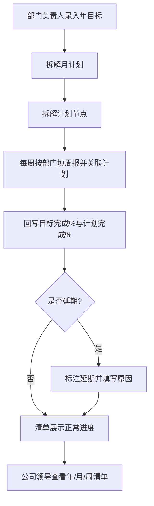

# 经营管理系统 PRD（V1.0.0 · 精简重做）

| 项目 | 内容 |
| --- | --- |
| 产品名称 | 经营管理系统 |
| 当前版本 | v1.0.0 |
| 版本更新时间 | 2026-09-17 |
| 版本迭代说明 | **精简重做**：仅公司领导 + 部门负责人；年/月/周三 Tab 清单；年目标→月计划→计划节点；部门周报关联计划并回写目标%/计划%；目标/计划/节点均可延期填原因。历史完整闭环见 v3.0.0 |
| 文档状态 | PC 原型已交付（经营清单三 Tab） |

---

## 目录

- [1. 产品概述](#1-产品概述)
- [2. 结论与范围](#2-结论与范围)
- [3. 业务流程](#3-业务流程)
- [4. 功能模块总览](#4-功能模块总览)
- [5. 用户交互路径](#5-用户交互路径)
- [6. 页面清单与跳转关系](#6-页面清单与跳转关系)
- [7. 字段与状态说明](#7-字段与状态说明)
- [8. 非功能性需求](#8-非功能性需求)
- [9. 风险项](#9-风险项)
- [10. 待确认](#10-待确认)

---

## 1. 产品概述

### 1.1 产品定位

面向码头经营管理的**轻量目标与周进度系统**：部门负责人把年目标拆到月计划与计划节点，每周按部门填写周报并挂到计划上；公司领导用年/月/周三张清单掌握进度与延期原因。

> 消息、审批、角色权限由公司统一内部平台提供，本 PRD **不设计**对应模块与页面。

### 1.2 产品目标

| 目标 | 说明 | 优先级 |
| --- | --- | --- |
| 清单可读 | 年目标、月计划、周填报以列表呈现，可筛选部门/周期 | P0 |
| 可拆解 | 部门负责人录入年目标 → 拆月计划 → 拆计划节点 | P0 |
| 可填报 | 按部门写本周/下周事项，并关联计划；回写目标完成%、计划完成% | P0 |
| 可解释延期 | 年目标、月计划、计划节点均可标延期并写原因 | P0 |
| 领导只看 | 公司领导全量只读，不填报 | P0 |

### 1.3 用户角色

| 角色 | 核心诉求 | 典型动作 | 优先级 |
| --- | --- | --- | --- |
| 公司领导 | 看清各部门目标、计划与本周进展 | 切换年/月/周清单；下钻延期原因 | P0 |
| 部门负责人 | 拆解目标并每周交卷 | 新建/编辑目标计划节点；填周报；标延期；更新完成% | P0 |
| 执行人员 | — | **本期不做** | — |

### 1.4 核心对象关系

```
年目标（部门）
  └─ 月计划（挂年目标）
       └─ 计划节点（挂月计划）
部门周报（按部门 × 周；须关联一个或多个月计划）
  └─ 回写：关联计划的「计划完成%」+ 所属年目标的「目标完成%」
```

---

## 2. 结论与范围

### 2.1 结论前置

**本版只做两件事**：① 部门负责人把年目标拆成月计划与节点，并每周按部门填报（挂计划、更新完成%）；② 公司领导用三 Tab 清单看进度与延期。不做执行人任务、季目标、专项、经营看板。

### 2.2 包含范围（In Scope）

| 模块 | 说明 | 优先级 |
| --- | --- | --- |
| 年目标清单 | 列表 + 新建/编辑；目标完成%；延期及原因 | P0 |
| 月计划清单 | 列表（含节点摘要）+ 新建/编辑月计划与节点；计划完成%；延期及原因 | P0 |
| 周填报清单 | 按部门×周列表；本周/下周；关联计划；回写两类完成% | P0 |
| 延期标注 | 年目标 / 月计划 / 计划节点均可 | P0 |

### 2.3 不包含（Out of Scope）

| 项 | 说明 |
| --- | --- |
| 执行人员任务、督办、转派 | 不做 |
| 季目标、专项、工作月报 | 不做 |
| 经营总览、生产、CRM、合同 | 不做 |
| 消息中心、审批流、权限配置页 | 平台能力，不设计 |

### 2.4 正常 / 边界 / 异常

#### 正常流程（P0）

1. 部门负责人新建年目标 → 拆月计划 → 为月计划增加计划节点。  
2. 每周填写部门周报：选周次、关联计划、写本周/下周、填目标完成%与计划完成%（可对多个关联计划分别填计划%）。  
3. 若目标/计划/节点延期：标记延期并填写原因；清单展示延期标识与原因摘要。  
4. 公司领导打开同一清单页，切换三 Tab 只读查看。

#### 边界情况（P1）

| 场景 | 处理 |
| --- | --- |
| 年目标尚无月计划 | 年 Tab 正常展示；月 Tab 无对应行；允许后续补拆 |
| 月计划尚无节点 | 允许；节点列显示「未拆节点」 |
| 周报关联多个计划 | 允许；本周/下周为部门总述；计划%按计划分别填写 |
| 领导身份 | 隐藏新建/编辑/填报按钮 |

#### 异常兜底（P1）

| 场景 | 处理 |
| --- | --- |
| 周报未关联计划 | 禁止提交 |
| 延期未填原因 | 禁止保存延期 |
| 完成% 非 0–100 | 校验拦截 |
| 本周或下周为空 | 禁止提交周报 |

---

## 3. 业务流程

### 3.1 主流程（文字 + Mermaid）



**解读**：拆解是前置；周报是进度入口，同时回写两类完成百分比；延期可在目标/计划/节点任一对象上发生，并在对应清单可见。

### 3.2 周报回写规则（P0）

| 回写字段 | 规则 |
| --- | --- |
| 计划完成% | 周报中为每个**关联的月计划**填写本周认定的完成%；保存后覆盖该计划当前完成% |
| 目标完成% | 周报中填写（或按关联计划所属年目标分别填写）本周认定的目标完成%；保存后覆盖对应年目标当前完成% |
| 历史周报 | 保留当周填写快照；清单「当前%」以最新一次成功保存为准 |

> 【待确认】若一周关联多个年目标下的计划：目标%是「每个目标各填一个」，还是「整部门只填一个总目标%」？原型默认：**按关联计划所属年目标分别填写目标%**。

---

## 4. 功能模块总览

| 模块 | 功能点 | 角色 | 优先级 |
| --- | --- | --- | --- |
| 年目标 Tab | 列表、筛选、新建/编辑、延期 | 负责人写 / 领导读 | P0 |
| 月计划 Tab | 列表（含节点）、新建/编辑计划与节点、延期 | 负责人写 / 领导读 | P0 |
| 周填报 Tab | 列表、新建/编辑周报、关联计划、回写% | 负责人写 / 领导读 | P0 |
| 角色切换（原型） | 演示用切换「公司领导 / 部门负责人」 | 原型专用 | P0 |

---

## 5. 用户交互路径

### 5.1 部门负责人 · 拆解

1. 打开经营清单 → 年目标 Tab → 新建年目标。  
2. 月计划 Tab → 新建月计划（选择所属年目标）→ 在详情/弹窗内增删计划节点。  
3. 需要延期时，在对应行点「标延期」→ 填原因 → 保存。

### 5.2 部门负责人 · 周填报

1. 周填报 Tab → 新建本周周报。  
2. 选择周次、确认部门（默认本部门）。  
3. 关联一个或多个月计划。  
4. 填写本周干了啥、下周干啥。  
5. 为关联计划填写计划完成%；为所属年目标填写目标完成%。  
6. 保存 → 年/月清单上的完成%立即更新。

### 5.3 公司领导 · 查阅

1. 打开经营清单，切换年 / 月 / 周 Tab。  
2. 按部门、周期筛选。  
3. 查看延期标识与原因；无编辑入口。

---

## 6. 页面清单与跳转关系

| 页面 | 路径（拟定） | 说明 | 优先级 |
| --- | --- | --- | --- |
| 版本入口 | `prototype/versions/v1.0.0/index.html` | 进入三菜单 | P0 |
| 年度目标 | `pages/年度目标_page.html` | 年目标列表与维护 | P0 |
| 月度计划 | `pages/月度计划_page.html` | 月计划 + 计划节点 | P0 |
| 周工作任务 | `pages/周工作任务_page.html` | 部门周报，关联计划并回写% | P0 |

**跳转**：侧栏三菜单互跳；新建/编辑/延期/详情均用弹窗。

> 不产出：消息、审批、权限配置、执行人任务相关页。

---

## 7. 字段与状态说明

### 7.1 年目标

| 字段 | 说明 | 必填 | 优先级 |
| --- | --- | --- | --- |
| 目标名称 | 文本 | 是 | P0 |
| 所属部门 | 枚举/组织 | 是 | P0 |
| 年度 | 如 2026 | 是 | P0 |
| 目标说明 | 文本 | 否 | P1 |
| 目标完成% | 0–100，整数；由周报回写，亦可负责人在目标编辑中修正 | 是（有默认 0） | P0 |
| 是否延期 | 是/否 | 是 | P0 |
| 延期原因 | 延期时必填 | 条件必填 | P0 |
| 更新时间 | 系统 | — | P1 |

### 7.2 月计划

| 字段 | 说明 | 必填 | 优先级 |
| --- | --- | --- | --- |
| 计划名称 | 文本 | 是 | P0 |
| 所属年目标 | 关联 | 是 | P0 |
| 所属部门 | 继承自目标，可展示 | 是 | P0 |
| 月份 | 如 2026-08 | 是 | P0 |
| 计划说明 | 文本 | 否 | P1 |
| 计划完成% | 0–100；由周报回写 | 是（默认 0） | P0 |
| 是否延期 | 是/否 | 是 | P0 |
| 延期原因 | 延期时必填 | 条件必填 | P0 |

### 7.3 计划节点

| 字段 | 说明 | 必填 | 优先级 |
| --- | --- | --- | --- |
| 节点名称 | 文本 | 是 | P0 |
| 所属月计划 | 关联 | 是 | P0 |
| 计划完成日 | 日期 | 否 | P1 |
| 是否延期 | 是/否 | 是 | P0 |
| 延期原因 | 延期时必填 | 条件必填 | P0 |

### 7.4 部门周报

| 字段 | 说明 | 必填 | 优先级 |
| --- | --- | --- | --- |
| 周次 | 如 2026-W34 | 是 | P0 |
| 部门 | 负责人本部门 | 是 | P0 |
| 关联月计划 | 多选，至少 1 个 | 是 | P0 |
| 本周干了啥 | 文本 | 是 | P0 |
| 下周干啥 | 文本 | 是 | P0 |
| 各计划完成% | 对每个关联计划填 0–100 | 是 | P0 |
| 各目标完成% | 对涉及的年目标填 0–100 | 是 | P0 |
| 填报人 | 当前部门负责人 | 系统 | P1 |
| 填报时间 | 系统 | — | P1 |

### 7.5 列表状态展示

| 状态 | 展示 | 优先级 |
| --- | --- | --- |
| 正常 | 完成% + 无延期标 | P0 |
| 延期 | 红色/警示「已延期」+ 原因摘要 | P0 |
| 未拆解 | 月计划数=0 或节点数=0 时提示 | P1 |
| 周报未填 | 领导视角可对「本周缺报部门」做简单提示（原型可用静态样例） | P2 |

---

## 8. 非功能性需求

| 项 | 要求 | 优先级 |
| --- | --- | --- |
| 端形态 | 以 GenUI 确认结果为准（默认倾向 PC Web） | P0 |
| 技术 | 原型：HTML + Tailwind CDN + 原生 JS | P0 |
| 数据 | 原型使用前端静态示例数据 | P0 |
| 权限 | 原型用角色切换模拟；正式权限走平台 | P0 |

---

## 9. 风险项

| 风险 | 影响 | 缓解 | 优先级 |
| --- | --- | --- | --- |
| 周报挂多计划时目标%填写繁琐 | 填报体验差 | 按涉及年目标去重展示目标%输入 | P1 |
| 「当前完成%」与历史周报不一致 | 领导误解 | 清单展示「当前%」；详情可看最近周报快照 | P1 |
| 与 v3.0.0 能力混淆 | 评审口径乱 | 入口与文档标明本版为精简重做 | P0 |

---

## 10. 待确认

| 编号 | 事项 | 默认（若未回复则按此实现） |
| --- | --- | --- |
| T1 | 多计划周报时目标完成%录入方式 | 按涉及的年目标分别填写 |
| T2 | 完成%是否允许在年/月编辑弹窗中手工改（不经过周报） | 允许，周报保存仍覆盖 |
| T3 | 原型端形态 | 见下方 GenUI 确认表单 |

---

## 附录 · 已确认需求摘要

| # | 确认项 | 结论 |
| --- | --- | --- |
| 1 | 清单形态 | 侧栏三菜单：年度目标 / 月度计划 / 周工作任务 |
| 2 | 完成百分比 | 目标完成% + 计划完成%；每周填周报时更新 |
| 3 | 延期 | 年目标、月计划、计划节点均可延期并填原因 |
| 4 | 周报粒度 | 按部门填写，须关联到计划 |
| 5 | 交付 | 先 PRD，确认平台后出原型 |
