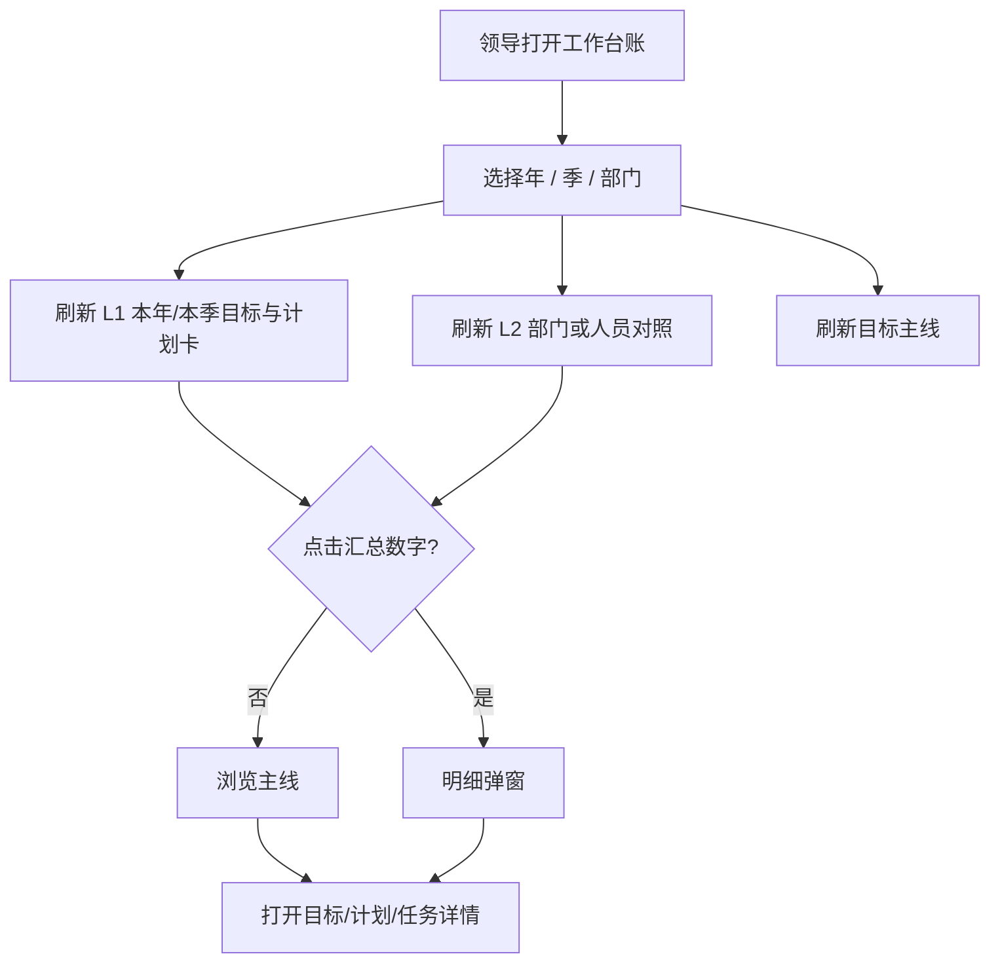

# 经营台账 · 工作台账 PRD（V1.0.0 增量）

| 项目 | 内容 |
| --- | --- |
| 产品名称 | 经营管理系统 |
| 模块名称 | 经营台账 · 工作台账（原「任务台账 / 部门工作台」） |
| 所属版本 | V1.0.0 |
| 文档类型 | 增量 PRD（对齐当前原型） |
| 原型路径 | `prototype/versions/v1.0.0/pages/部门工作台_部门工作台_page.html` |
| 修订日期 | 2026-09-12 |
| 文档状态 | 已对齐已确认原型规则；待确认项见文末 |

---

## 1. 结论前置

工作台账是公司领导的**日常总览页**，按 **年 / 季 / 部门** 查看目标、计划、任务的完成与延期汇总，并下钻主线。

| 定位 | 说明 | 优先级 |
| --- | --- | --- |
| 本页做什么 | 领导了解整体情况：目标健康与完成、计划完成/延期、任务完成/延期 | P0 |
| 本页不做什么 | **不做催填**（催填在工作周报）；**不做量化达成**（当前值/目标值本期不做） | P0 |
| 对象关系 | 年目标 → 季目标 → 计划（**仅挂季目标**）→ 任务 | P0 |

与另两页错位：

| 页面 | 定位 |
| --- | --- |
| **工作台账** | 年/季维度 · 目标 / 计划 / 任务完成汇总 |
| **工作周报** | 周会议程 · 催填 / 上周闭环 / 本周计划 |
| **工作月报** | 月会交卷 · 部门/专项确认进度 |

---

## 2. 目标与价值

| 目标 | 说明 | 优先级 |
| --- | --- | --- |
| 一眼看整体 | 本年/本季目标、计划、任务用汇总数字呈现 | P0 |
| 按部门对照 | 各部门（或人员）横向对比完成与延期 | P0 |
| 可下钻 | 点数字看明细；点目标进主线与详情 | P0 |
| 口径清晰 | 年目标不挂计划；健康仅「正常 / 关注」 | P0 |

---

## 3. 角色与权限

| 角色 | 可见范围 | 可操作 | 优先级 |
| --- | --- | --- |
| 公司领导 / 经营管理人员 | 全港或按部门筛选 | 筛选、汇总下钻、打开详情、展开关注主线 | P0 |
| 部门负责人 | 默认本部门；可看本部门对照与主线 | 同左（范围受限） | P0 |
| 普通执行人 | 是否可见由管理员在统一平台自行配置；本 PRD 不强制 | 默认可走工作周报/我的任务 | P2 |

> 消息、审批、角色菜单由统一内部平台提供；本模块不建设权限配置页。

---

## 4. 信息架构与页面

### 4.1 菜单位置

| 一级 | 二级 | 说明 | 优先级 |
| --- | --- | --- | --- |
| 经营台账 | **工作台账** | 原「任务台账」；侧栏第一项经营入口 | P0 |
| 经营台账 | 工作周报 | 周会议程与催填 | P0 |
| 经营台账 | 工作月报 | 月会交卷确认 | P0 |

### 4.2 页面结构

| 区域 | 内容 | 优先级 |
| --- | --- | --- |
| 顶栏筛选 | **年**、**季**（含「全部季」）、**部门**（全港 / 指定部门） | P0 |
| L1 汇总卡 | 本年目标、本季目标、计划（随季）三组；见 §5 | P0 |
| L2 部门执行对照 | 全港=按部门行；指定部门=按人员行；见 §6 | P0 |
| 目标主线 | 年目标 + 本季目标树；关注目标默认可展开；详情弹窗 | P0 |

不展示：待周报催填人数卡、滞后任务作为顶栏主 KPI、量化达成列。

---

## 5. L1 汇总卡（目标分开展示）

### 5.1 本年目标

| 指标 | 口径 | 优先级 |
| --- | --- | --- |
| 总数 | 筛选年 + 部门范围内的 **年目标** 条数 | P0 |
| 已完成 | 业务状态 = 已完成 | P0 |
| 关注 | 健康状态 = 关注 | P0 |

### 5.2 本季目标

| 指标 | 口径 | 优先级 |
| --- | --- | --- |
| 总数 | 筛选年 + 季 + 部门范围内的 **季目标** 条数；季=「全部季」时汇总该年各季 | P0 |
| 已完成 | 业务状态 = 已完成 | P0 |
| 关注 | 健康状态 = 关注 | P0 |

### 5.3 计划（随季）

| 指标 | 口径 | 优先级 |
| --- | --- | --- |
| 总数 | 挂在本季目标池下的计划条数 | P0 |
| 节点逾期/临期 | 节点已逾期或 7 日内到期（顶栏快速风险） | P0 |
| 已延期 | 计划业务状态 = 已延期 | P0 |

> **已确认（T2=B）：** 顶栏计划组保持「总数 / 节点逾期临期 / 已延期」，与对照表「总数 / 已完成 / 已延期」互补——顶栏盯节点风险，对照表看完成结构。

点击指标打开明细弹窗；目标类可跳转主线定位。

---

## 6. L2 部门执行对照

### 6.1 表头结构（P0）

| 分组 | 列 |
| --- | --- |
| 年目标 | 总数 · 已完成 · 关注 |
| 本季目标 | 总数 · 已完成 · 关注 |
| 本年计划 | 总数 · 已完成 · 已延期 |
| 本季计划 | 总数 · 已完成 · 已延期 |
| 本年任务 | 总数 · 已完成 · 已延期 |
| 本季任务 | 总数 · 已完成 · 已延期 |

### 6.2 统计口径

| 对象 | 范围规则 |
| --- | --- |
| 年目标 | `type=年` 且所属年=筛选年；按行部门（或人员=目标负责人）切分 |
| 本季目标 | `type=季` 且所属年=筛选年；季≠全部时 period=年-Qx |
| 本年计划 | 挂在该年**全部季目标**下的计划合计（不受「季」下拉限制） |
| 本季计划 | 仅挂在本季目标池下的计划 |
| 本年任务 | 本年各季计划下任务合计 |
| 本季任务 | 本季计划下任务 |
| 计划已完成 / 已延期 | `planStatus` = 已完成 / 已延期 |
| 任务已完成 | 任务业务状态 = 已完成 |
| 任务已延期 | 业务状态 = **已延期** 或 **未更新**（已确认：未更新计入已延期汇总） |

**切分规则（已确认）：** 对照表以**部门**为责任单元切分；不按任务个人责任人另切。指定部门时若展示人员行，仅作部门内成员浏览，任务数仍归属该部门汇总口径，不单独按任务责任人重算。

**说明：** 年目标**不挂计划**；无独立「年计划」对象，「本年计划」= 各季计划合计。

### 6.3 交互

| 交互 | 规则 | 优先级 |
| --- | --- | --- |
| 点击数字 | 弹窗列出对应明细 | P0 |
| 点击部门名 | 切换部门筛选并定位主线 | P0 |
| 指定部门 | 可展示部门内人员浏览行；统计责任仍在部门 | P1 |

---

## 7. 目标主线与详情

| 能力 | 说明 | 优先级 |
| --- | --- | --- |
| 展示范围 | 当前年的年目标 + 符合季筛选的季目标 | P0 |
| 标签 | 年/季类型、健康（正常/关注）、业务状态 | P0 |
| 展开 | 关注目标默认可展开；支持「展开关注目标」 | P0 |
| 详情 | 大弹窗：业务状态、健康、关联计划数、滞后/未更新任务、落地全景（目标→计划→任务） | P0 |
| 年目标 | 不挂计划；文案提示落地在季目标 | P0 |

---

## 8. 状态与健康

### 8.1 目标健康（两档 · 已确认）

| 状态 | 判定要点 | 优先级 |
| --- | --- | --- |
| 正常 | 无滞后任务；本周期关键任务已更新；无计划关键节点逾期 | P0 |
| 关注 | 有滞后任务 / 关键任务未更新 / 节点逾期 / 临期未分解等（满足任一） | P0 |

**禁止：** 目标健康枚举使用「异常」「风险」「需关注」。

允许人工 override 为正常/关注，**改状态必填原因**。

年/季目标健康**独立计算**，不做下级加总。

### 8.2 业务状态（与健康独立）

| 对象 | 常用枚举（首版） |
| --- | --- |
| 目标 | 草稿 / 进行中 / 已完成 / 已延期 / 已取消 |
| 计划 | 进行中 / 已完成 / 已延期 |
| 任务 | 进行中 / 已完成 / 已延期 / 未更新 等 |

汇总「已完成」取业务状态=已完成；汇总「已延期」= **已延期 + 未更新**（不取健康）。

### 8.3 本期不做

| 项 | 说明 |
| --- | --- |
| 量化达成 | 不展示、不录入当前值/目标值；顺延后续版本 |
| 完成率（%） | 全链路不使用 |
| 催填入口 | 不在本页做待填报人数汇总；见工作周报 |

---

## 9. 业务流程

**文字解读：** 筛选驱动全部汇总与主线；顶栏看结构，对照表看部门差异，主线看落地链路；催填不在此闭环内。

### 正常流程

选年季部门 → 看本年/本季目标完成与关注 → 看计划/任务完成与延期 → 点异常部门下钻 → 主线跟进。

### 边界情况

| 场景 | 处理 |
| --- | --- |
| 季=全部季 | 本季目标/本季计划/本季任务按该年各季合计；副文案标明「全部季」 |
| 某部门无年目标 | 年目标三列均为 0 |
| 年目标无下级季 | 年目标可计；本年计划/任务可为 0 |
| 业务已完成且健康仍为关注 | 两列分别计数；详情注明健康与业务独立 |

### 异常兜底

| 场景 | 处理 |
| --- | --- |
| 计划误挂年目标 | 产品禁止；不计入计划池 |
| 筛选无数据 | 对照表与主线空态提示 |
| 明细为空 | 弹窗「暂无数据」 |

---

## 10. 与周报 / 月报边界

| 能力 | 工作台账 | 工作周报 | 工作月报 |
| --- | --- | --- | --- |
| 年季总览 | ✅ | ❌ | ❌ |
| 催填 | ❌ | ✅ | 一键催确认 |
| 周任务闭环 | ❌（仅汇总） | ✅ | ❌ |
| 月度文字确认 | ❌ | ❌ | ✅ |

---

## 11. 风险项

| 风险 | 影响 | 应对 | 优先级 |
| --- | --- | --- | --- |
| 「本年计划」被理解成独立年计划对象 | 口径争议 | PRD/界面副文案写明「各季合计」 | P0 |
| 对照表列过多 | 扫读成本 | 分组表头 + 横滑；禁止再叠催填列 | P1 |
| 历史文档仍写三档健康 | 研发混乱 | 以本文 §8.1 与主 PRD §7.10.1 为准 | P0 |

---

## 12. 验收要点（P0）

| 编号 | 验收项 |
| --- | --- |
| A1 | 菜单名为「工作台账」 |
| A2 | 支持年、季（含全部季）、部门筛选，L1/L2/主线联动 |
| A3 | 本年目标与本季目标分开展示：总数 / 已完成 / 关注 |
| A4 | 对照表：本年/本季计划为总数 / 已完成 / 已延期 |
| A5 | 对照表：本年/本季任务为总数 / 已完成 / 已延期（未更新计入已延期） |
| A6 | 目标健康仅正常/关注；无异常/风险/需关注枚举 |
| A7 | 无量化达成展示；无待周报催填汇总卡 |
| A8 | 年目标不挂计划；计划仅挂季目标 |
| A9 | 对照以部门为责任单元，不按任务个人责任人切分 |
| A10 | 顶栏计划组为总数/节点逾期临期/已延期（与对照表完成结构互补） |

---

## 【待确认】

无。T1–T4 均已确认（T2=B）。

---

**文档结束（工作台账 · V1.0.0 增量）**
