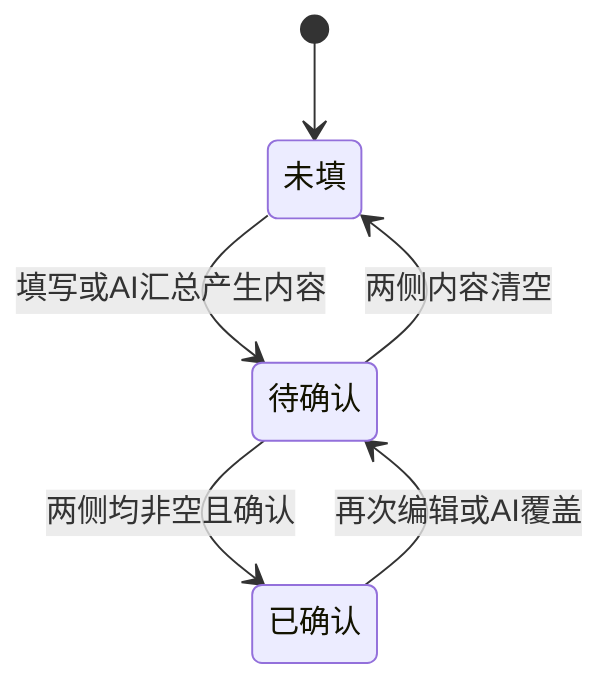
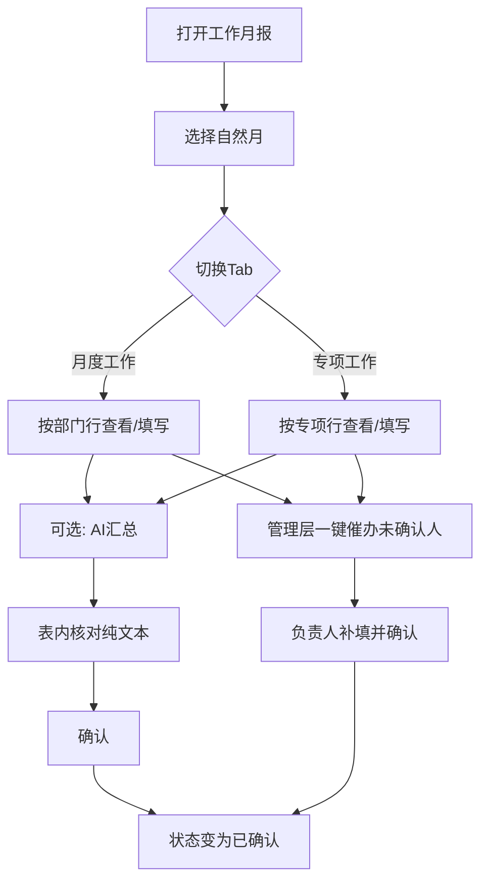

# 经营台账 · 工作月报 PRD（V1.0.0 增量）

| 项目 | 内容 |
| --- | --- |
| 产品名称 | 经营管理系统 |
| 模块名称 | 经营台账 · 工作月报 |
| 所属版本 | V1.0.0 |
| 文档类型 | 增量 PRD（对齐当前原型） |
| 原型路径 | `prototype/versions/v1.0.0/pages/经营台账_工作月报_page.html` |
| 修订日期 | 2026-09-12 |
| 文档状态 | 已对齐已确认原型规则；待确认项见文末 |

---

## 1. 结论前置

工作月报为经营台账下**独立菜单**（位于工作周报下方），按**自然月**管理两类纯文本汇报：

| Tab | 填报维度 | 确认人 | 优先级 |
| --- | --- | --- | --- |
| 月度工作 | 组织架构部门一行 | **部门负责人**（取自固定组织架构，本页不可改派） | P0 |
| 专项工作 | 专项一行 | **专项负责人**（每专项仅 **1** 人，单人确认） | P0 |

每行均维护「本月完成工作」「下月工作计划」两段纯文本；支持行内直接编辑、行级 AI 汇总、行级确认；顶部提供一键催办（催当前 Tab 未确认行）。

与工作周报关系：**菜单独立、能力独立**；周报继续服务「目标/计划/任务周期快照」；月报服务「部门/专项月度文字汇报」。

---

## 2. 目标与价值

| 目标 | 说明 | 优先级 |
| --- | --- | --- |
| 部门月度可汇总 | 部门负责人对本月完成、下月计划形成可确认文本 | P0 |
| 专项月度可汇总 | 专项负责人对专项维度完成同样确认 | P0 |
| 降低填写成本 | AI 汇总本月已填任务进展与已登记下月计划，负责人核对后确认 | P0 |
| 催办闭环 | 管理层可一键催未确认负责人（企微个人消息，配置见消息配置） | P0 |

---

## 3. 角色与权限

| 角色 | 可见范围 | 可操作 | 优先级 |
| --- | --- | --- | --- |
| 公司领导 / 经营管理人员 | 全部启用部门 + 全部专项 | 查看、一键催办、代编辑（若组织授权） | P0 |
| 部门负责人 | 本部门月度工作行 | 行内编辑、AI 汇总、确认 | P0 |
| 专项负责人 | 本人负责专项行 | 行内编辑、AI 汇总、确认 | P0 |
| 普通执行人 | 默认无月报菜单，或只读本人相关部门摘要 | 【待确认】是否开放只读 | P1 |

> 消息、审批、角色菜单权限由统一内部平台提供；本模块不建设权限配置页。

---

## 4. 信息架构与页面

### 4.1 菜单位置

| 一级 | 二级 | 说明 | 优先级 |
| --- | --- | --- | --- |
| 经营台账 | 工作周报 | 既有周周期快照页 | P0 |
| 经营台账 | 工作月报 | 本需求新增；紧挨周报下方 | P0 |

### 4.2 页面结构

| 区域 | 内容 | 优先级 |
| --- | --- | --- |
| Tab | 月度工作 / 专项工作 | P0 |
| 进度摘要 | 本月已确认 x/y；下月计划已确认 x/y（口径见状态章） | P0 |
| 工具栏 | 自然月选择、搜索、一键催办 | P0 |
| 列表 | 见字段表；「本月完成」「下月计划」表内直接编辑 | P0 |
| 操作列 | 仅 **AI汇总**、**确认**（已确认行仅 AI汇总） | P0 |

不展示：顶部说明文案、批量 AI 汇总、导出、行内编辑弹窗、行内催办。

---

## 5. 字段与列表

### 5.1 月度工作（部门维度）

| 字段 | 类型 | 必填 | 说明 | 优先级 |
| --- | --- | --- | --- | --- |
| 序号 | 数字 | — | 列表序号 | P0 |
| 部门 | 文本 | 是 | 来自启用范围内组织架构部门 | P0 |
| 部门负责人 | 人员 | 是 | **固定取组织架构部门主责**，本页不可改派 | P0 |
| 本月完成工作 | 多行纯文本 | 确认时必填 | 表内直接编辑 | P0 |
| 下月工作计划 | 多行纯文本 | 确认时必填 | 表内直接编辑 | P0 |
| 状态 | 枚举 | 是 | 未填 / 待确认 / 已确认 | P0 |
| 操作 | 按钮 | — | AI汇总、确认 | P0 |

列顺序（P0）：序号 → 部门 → 部门负责人 → 本月完成工作 → 下月工作计划 → **状态** → 操作。

### 5.2 专项工作（专项维度）

| 字段 | 类型 | 必填 | 说明 | 优先级 |
| --- | --- | --- | --- | --- |
| 序号 | 数字 | — | 列表序号 | P0 |
| 专项名称 | 文本 | 是 | 来自专项管理 | P0 |
| 专项负责人 | 人员 | 是 | **每专项仅 1 人**，由其单人确认 | P0 |
| 协同部门 | 文本 | 否 | 展示协同部门，不参与多人会签 | P0 |
| 本月完成工作 | 多行纯文本 | 确认时必填 | 表内直接编辑 | P0 |
| 下月工作计划 | 多行纯文本 | 确认时必填 | 表内直接编辑 | P0 |
| 状态 | 枚举 | 是 | 未填 / 待确认 / 已确认 | P0 |
| 操作 | 按钮 | — | AI汇总、确认 | P0 |

列顺序（P0）：序号 → 专项名称 → 专项负责人 → 协同部门 → 本月完成 → 下月计划 → **状态** → 操作。

---

## 6. 状态机

| 状态 | 进入条件 | 可操作 |
| --- | --- | --- |
| 未填 | 本月完成与下月计划均为空 | AI汇总；编辑后变待确认 |
| 待确认 | 任一侧有内容且尚未确认；或已确认后再编辑/AI覆盖 | AI汇总、确认、一键催办覆盖 |
| 已确认 | 两侧均非空且点击确认 | 可继续表内编辑 / AI汇总，编辑或 AI 后回退为待确认 |

**确认规则（P0）：** 本月完成与下月计划均需非空，否则拦截并提示。  
**进度摘要口径（P0）：**

| 指标 | 口径 |
| --- | --- |
| 本月已确认 | 状态=已确认 的行数 / 当前 Tab 总行数 |
| 下月计划已确认 | 状态=已确认且下月计划非空 的行数 / 总行数（与已确认行同步） |

---

## 7. 核心规则

### 7.1 组织与负责人（已确认）

| 规则 | 说明 | 优先级 |
| --- | --- | --- |
| 部门来源 | 仅展示「使用范围」启用的部门 | P0 |
| 部门负责人 | 固定组织架构主责，月报页禁止改派 | P0 |
| 专项负责人 | 每专项仅 1 人确认，不支持多人会签 | P0 |
| 周期 | 自然月（如 2026-08）；截止日默认月末 | P0 |

### 7.2 AI 汇总（P0）

| 项 | 说明 |
| --- | --- |
| 入口 | 仅操作列「AI汇总」（无批量入口） |
| 本月完成 | 自动汇总该部门/专项本月已填报工作任务进展（情况说明/完成说明/阻塞等）为纯文本 |
| 下月计划 | 自动汇总已填写/已登记的下月工作计划条目为纯文本 |
| 覆盖策略 | 写入后状态变为待确认；需负责人再次确认 |
| 失败兜底 | 无关联任务/计划时生成空结果提示文案，不阻断手动填写 |

### 7.3 一键催办（P0）

| 项 | 说明 |
| --- | --- |
| 范围 | 当前 Tab 中状态 ≠ 已确认 的行 |
| 对象 | 去重后的部门负责人或专项负责人 |
| 通道 | 企微个人消息（与消息配置一致） |
| 文案要素 | 周期（自然月）+ 月报待确认提示 |
| 空态 | 全部已确认时提示无需催办 |

### 7.4 与周报 / 消息配置关系

| 关联 | 说明 | 优先级 |
| --- | --- | --- |
| 工作周报 | 独立页面与数据；不互相覆盖文本 | P0 |
| 消息配置 | 月报到期可经 Webhook 推群（周期+未填名单）；一键催办走个人消息 | P0 |
| 任务归属周 | 任务仍可标注归属周；月报 AI 按自然月聚合任务 | P0 |

---

## 8. 业务流程

### 8.1 正常流程

**文字解读：** 负责人按月打开对应 Tab，可直接在表格编辑两段文本，或先 AI 汇总再改；内容齐全后确认。管理层对未确认行一键催办。

### 8.2 边界情况

| 场景 | 处理 | 优先级 |
| --- | --- | --- |
| 新启用部门当月无任务 | 允许空内容保持未填；AI 给出无任务提示 | P0 |
| 专项无协同部门 | 协同部门显示「—」 | P0 |
| 已确认后修改 | 自动回退待确认，需重新确认 | P0 |
| 搜索无结果 | 空态提示 | P0 |

### 8.3 异常兜底

| 场景 | 处理 | 优先级 |
| --- | --- | --- |
| 确认时缺一侧文本 | 拦截，提示两侧均需填写 | P0 |
| AI 服务失败 | Toast 失败；保留原文本 | P0 |
| 催办通道失败 | Toast 失败；不改变状态 | P0 |
| 组织负责人变更 | 次月按新主责展示；当月已确认记录保留历史负责人快照【待确认】 | P1 |

---

## 9. 非功能

| 项 | 要求 | 优先级 |
| --- | --- | --- |
| 终端 | PC Web；V1 不做企微独立月报页 | P0 |
| 性能 | 单 Tab ≤ 200 行时可流畅行内编辑 | P1 |
| 审计 | 确认动作记操作人、时间 | P1 |
| 导出 | 本版不做 | P2 |

---

## 10. 风险项

| 风险 | 影响 | 建议 |
| --- | --- | --- |
| 与历史「工作汇报周/月同页」PRD 表述冲突 | 研发口径混乱 | 以本章 + 独立菜单为准，旧 4.7.1「单页 Tab 周/月」视为过时 |
| AI 汇总质量不稳定 | 负责人不愿用 | 强调可改；失败可手填 |
| 部门负责人与实际填报人不一致 | 确认权责不清 | 严格组织架构主责；代填需授权策略【待确认】 |
| 月报纯文本与周报任务明细双口径 | 领导对照成本 | 月报定位「定性汇总」，周报定位「任务执行快照」 |

---

## 11. 原型与验收对照

| 验收点 | 期望 | 优先级 |
| --- | --- | --- |
| 菜单 | 经营台账下独立「工作月报」 | P0 |
| Tab | 月度工作 / 专项工作 | P0 |
| 列序 | 状态在下月计划之后 | P0 |
| 编辑 | 表内直接编辑，无编辑弹窗 | P0 |
| 操作 | 仅 AI汇总、确认 | P0 |
| 催办 | 仅顶部一键催办 | P0 |
| 负责人 | 部门固定组织；专项单人 | P0 |

---

## 12. 【待确认】

| 编号 | 问题 | 影响 |
| --- | --- | --- |
| T1 | 普通执行人是否可见月报只读入口？ | 菜单与数据权限 |
| T2 | 领导/管理员可否代部门负责人确认？ | 确认权责 |
| T3 | 组织负责人月中变更时，当月行是否换人、历史确认是否快照？ | 数据模型 |
| T4 | 月报 AI 的任务纳入范围：仅「归属周落在本月」还是「任务起止与本月有交集」？ | AI 口径 |
| T5 | 下月计划是否必须来自系统已建任务，还是允许纯手写？ | 校验规则 |
| T6 | 是否需要与消息配置中的「月报到期群推」共用同一未填口径（未确认=未填）？ | 推送名单 |

---

## 13. 修订记录

| 日期 | 说明 |
| --- | --- |
| 2026-09-12 | 首版：对齐原型（双 Tab、表内编辑、状态列后移、操作精简、一键催办、组织/单人确认） |
