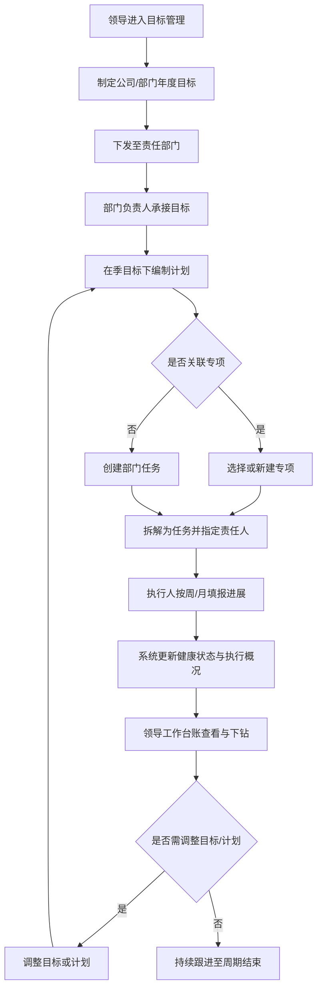
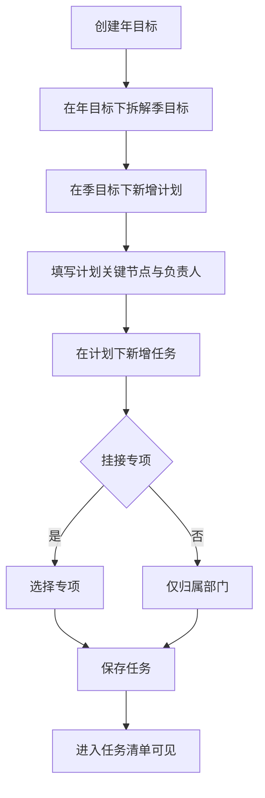
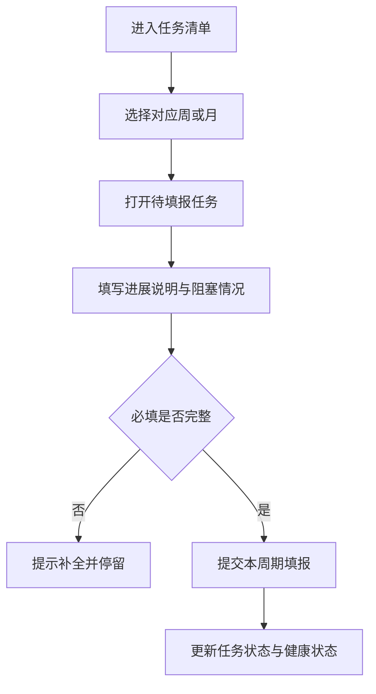
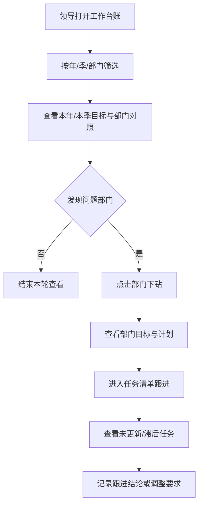
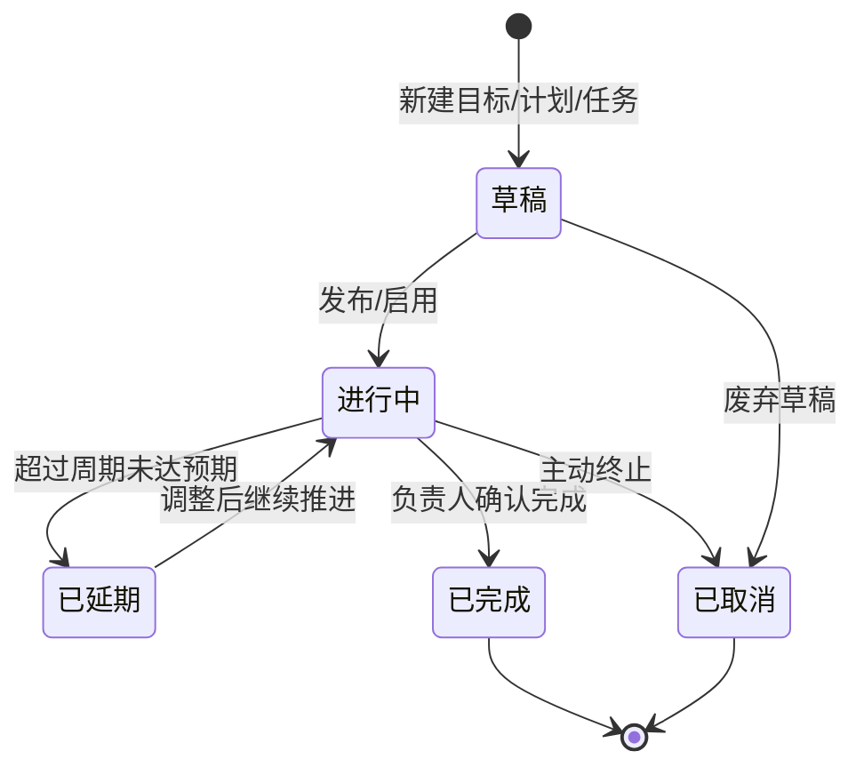
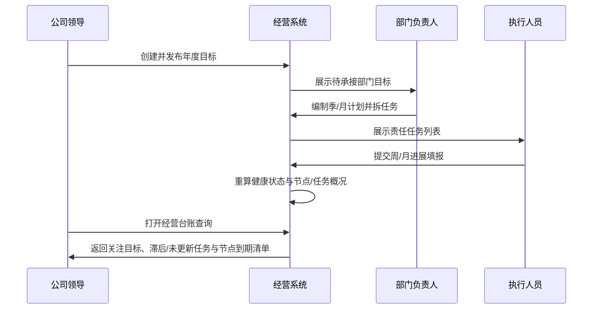
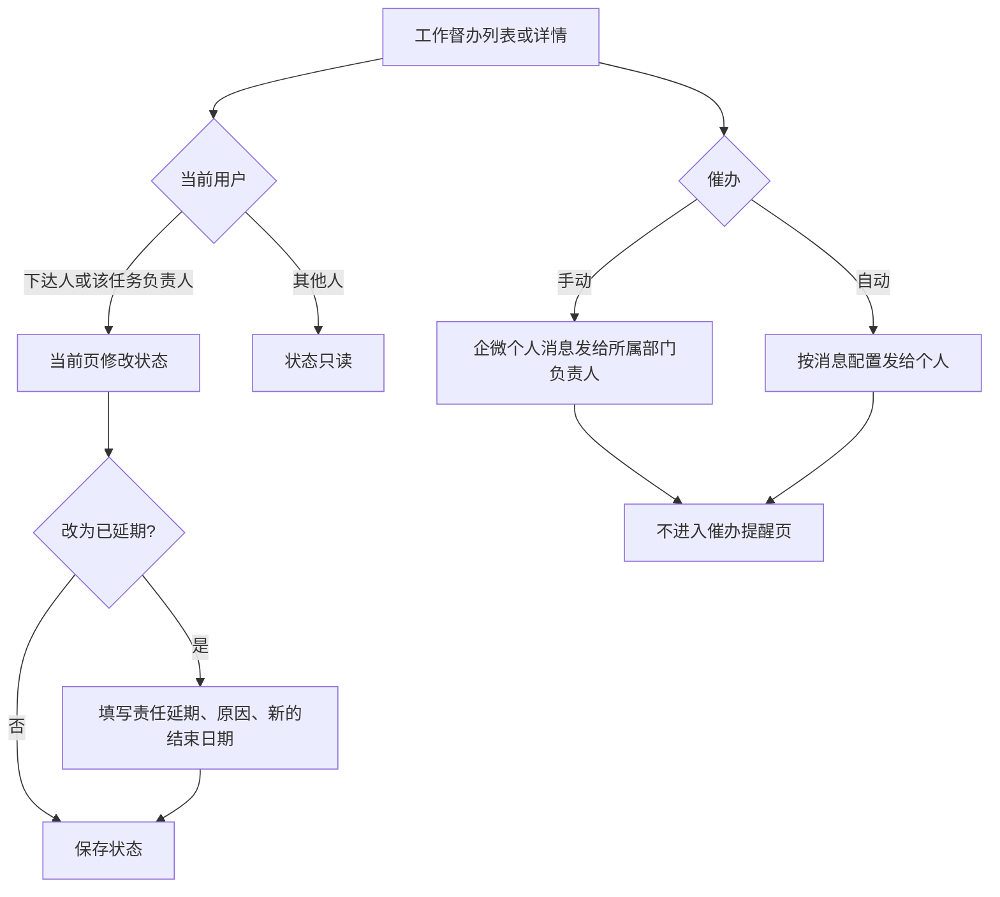
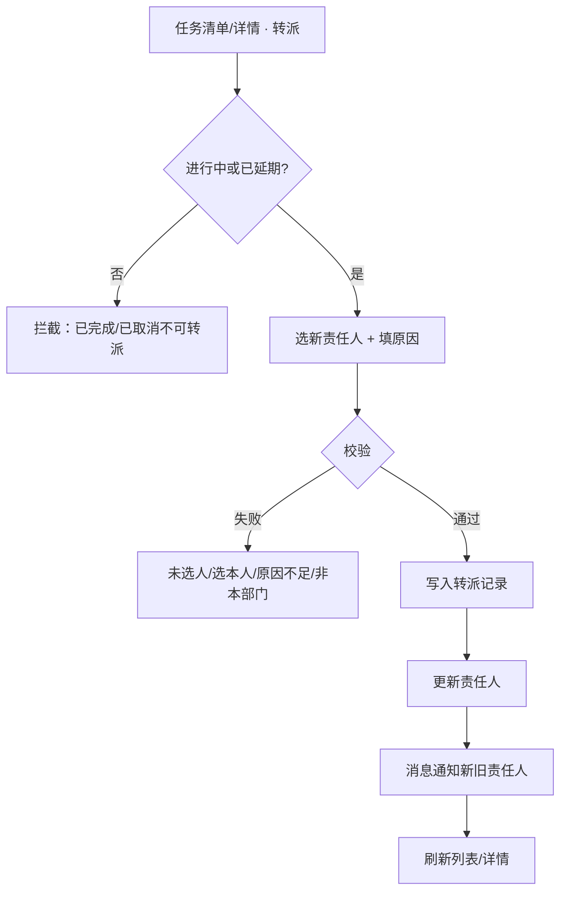
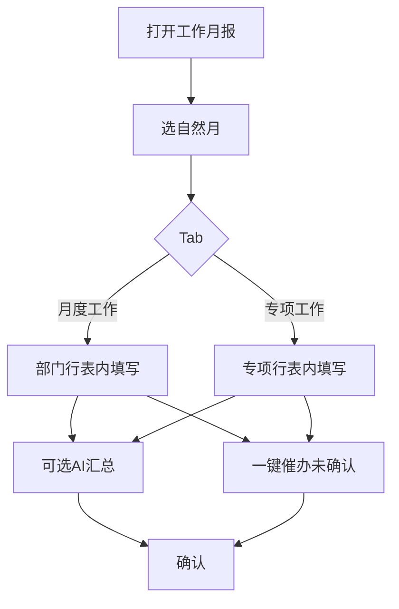
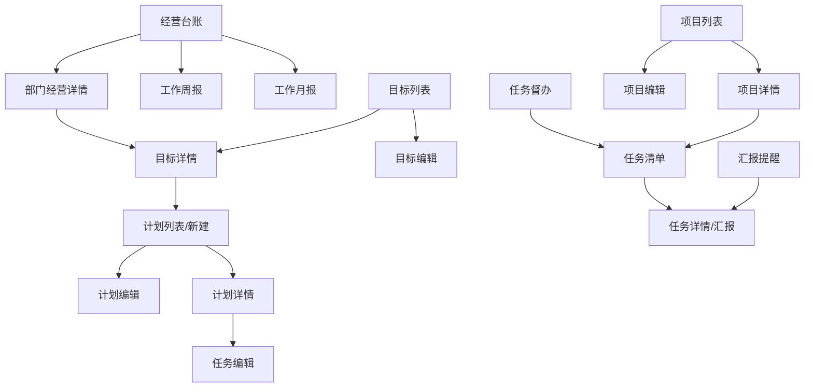

# 经营管理系统 PRD

| 项目 | 内容 |
| --- | --- |
| 产品名称 | 经营管理系统 |
| 当前版本 | v1.1.0 |
| 版本更新时间 | 2026-09-21 |
| 版本迭代说明 | **增量：任务转派**（须留转派记录；发布后禁止编辑改责任人）；**本轮补充：工作督办页内改状态、督办催办**；催办提醒独立页本期不做；继承 v1.0.0 目标/计划/任务闭环 |
| 文档状态 | 基于 v1.0.0；本版含任务转派，并补充工作督办状态与催办 |
| 依赖版本 | 依赖 v1.0.0 目标 / 计划 / 任务主数据 |
| 范围说明 | [`scope.md`](./scope.md) |

---

## 目录

> 相对 v1.0.0 的增量能力：**任务转派**（§4.4.8）。2026-09-21 补充：**工作督办页内改状态与催办**（§4.4.2）；**催办提醒独立页本期不做**。

- [1. 产品概述](#1-产品概述)
- [2. 结论与范围](#2-结论与范围)
- [3. 业务流程](#3-业务流程)
- [4. 功能模块总览](#4-功能模块总览)
- [5. 用户交互路径 User Flows](#5-用户交互路径-user-flows)
- [6. 页面清单与跳转关系](#6-页面清单与跳转关系)
- [7. 字段与状态说明](#7-字段与状态说明)
- [8. 非功能性需求](#8-非功能性需求)
- [9. 风险项](#9-风险项)
- [10. 待确认](#10-待确认)

---

## 1. 产品概述

### 1.1 产品定位

面向**码头日常运营**的经营目标对齐与过程可视系统（非软件产品研发场景）：按**部门 / 专项**双维度管理目标与任务，目标按**年→季**拆解（**不到月**）；计划挂季；任务支持**周**进展填报，让管理层随时掌握「目标是什么、做到哪、卡在哪」。

典型对象示例：装卸效率、泊位周转、堆存周转、设备完好率、安全环保、班组出勤、商务箱量等。

> 说明：消息、审批、角色与菜单权限由公司统一内部平台提供，本 PRD **不设计**对应模块与页面。

### 1.2 产品目标

| 目标 | 说明 | 优先级 |
| --- | --- | --- |
| 目标可下达 | 领导可制定公司/部门级经营目标与计划 | P0 |
| 目标可管理 | 目标含介绍、截止时间；状态可改且**必须填写原因** | P0 |
| 目标可分解 | 部门将目标拆为可执行任务，挂靠**专项**可选 | P0 |
| 过程可填报 | 任务按周维护进展；工作周报/月报做会议交卷 | P0 |
| 结果可看见 | 领导按部门/专项查看目标达成与跟进状态 | P0 |
| 视图可切换 | 任务中心以「任务清单 / 任务督办 / 专项管理」为主入口；催填并入工作周报 | P0 |

### 1.3 用户角色定义

| 角色 | 核心诉求 | 典型动作 |
| --- | --- | --- |
| 公司领导 | 掌握各部门目标与达成情况 | 制定/调整目标；查看工作台账；开周报/月报；下钻部门/专项 |
| 部门负责人 | 承接公司目标并拆解落地 | 接收目标；拆计划/任务；分配责任人；汇总进度 |
| 专项负责人 | 在专项维度推进任务 | 维护专项任务；周/月填报；标记风险 |
| 执行人员 | 明确本人任务与进度 | 填报周/月进展；更新完成情况 |

### 1.4 核心业务对象关系（文字）

```
公司/部门目标（年 → 季；季为最末级，禁止再拆月）
  └─ 目标计划（仅挂季目标；年目标不挂计划；一季目标可挂多计划）
       └─ 任务（可关联专项）
            └─ 周期填报（周进展为主）
专项（可选挂载，如设备专项、安全专项、堆场专项）
```

---

## 2. 结论与范围

### 2.1 结论前置

**v1.1.0 在 v1.0.0「目标 → 计划 → 任务 → 汇报填报 → 领导台账」闭环之上，新增任务转派（须留转派记录；发布后禁止编辑静默改责任人）**；分部门、分**专项**管理；目标含介绍、截止时间与可改状态（改状态必填原因）；任务中心含任务清单、任务督办、专项与转派；催填能力并入工作周报（汇报提醒侧栏隐藏）；**催办提醒独立菜单/页面本期全部隐藏、不做**；工作督办在当前页改状态（与计划、目标同一改法），并支持手动催办（向所属部门负责人发企微个人消息）与可配置的自动催办（企微个人消息）；**全链路不使用完成率（%）**，亦**不做量化达成（当前值/目标值）**；改以「健康状态、关键节点、任务执行概况」展示进度；不建设独立审批/消息/权限配置页面。

### 2.2 包含范围（In Scope）

| 模块 | 说明 | 优先级 |
| --- | --- | --- |
| 经营台账 | 工作台账 / 工作周报 / 工作月报（不含经营总览） | P0 |
| 目标管理 | 制定、介绍、截止时间、状态修改（必填原因）、分解 | P0 |
| 计划管理 | 计划编制与关键节点；**仅关联季目标** | P0 |
| 任务中心 | 任务清单、任务督办、专项管理；任务创建/分配/进展更新；**任务转派** | P0 |
| 专项管理 | 专项建档、归属部门、挂接任务（原「项目」） | P0 |
| 工作台账 | 领导按年/季/部门总览目标·计划·任务完成情况（原「任务台账 / 部门工作台」） | P0 |
| 任务跟踪评论 | 任务大弹窗内评论、附件、编辑/删除本人评论 | P0 |
| 催填能力 | 工作周报页内催填；汇报提醒菜单本期隐藏 | P0 |
| 工作督办改状态 | 在督办列表/详情当前页修改状态，改法与计划、目标一致；下达人与该任务负责人可改 | P0 |
| 工作督办催办 | 手动催办向所属部门负责人发企微个人消息；自动催办按消息配置（开关、触发条件、对象、频次、文案）发个人。不依赖催办提醒页 | P0 |

### 2.3 交互约束（本轮补充）

| 约束 | 说明 | 优先级 |
| --- | --- | --- |
| 新增统一弹窗 | 目标 / 计划 / 任务 / 专项的「新建、编辑」均使用标准 UI 弹窗 | P0 |
| 详情统一弹窗 | 目标 / 计划 / 任务 / 专项详情均在弹窗内查看 | P0 |
| 目标状态变更 | 修改目标状态时**必须填写变更原因**，否则不可保存 | P0 |
| 目标周期与截止 | 目标仅**年 / 季**两级；各级均有周期值与截止时间；**不做月目标** | P0 |
| 目标拆解递进 | 先建年目标 → 拆季目标；季必须挂年；**季为最末级**，禁止再拆月 | P0 |
| 目标关联展示 | 上下级仅做关联展示与下钻，不做下级指标强制加总校验 | P0 |
| 进度展示口径 | **全链路不使用完成率（%）**，亦**不做量化达成**；目标看健康（正常/关注）+ 业务完成；计划/任务看完成与延期汇总 | P0 |
| 工作台账 | 领导按年/季筛选总览；部门对照含目标/计划/任务汇总；催填不在本页 | P0 |

### 2.4 不包含范围（Out of Scope）

| 项 | 说明 |
| --- | --- |
| 经营总览 / 部门·项目经营详情 | 非本版 |
| 合同管理 / 开票记录 / 收款记录 | 非本版 |
| 量化指标达成（当前值/目标值） | 非本版；以健康状态 + 关键节点 + 任务执行概况替代 |
| 生产作业 / 完整 CRM / 档案 / 知识库 / AI / 经营报表 | 非本版 |
| 消息中心 / 待办推送本体 | 走内部平台；本系统仅提供「提醒」业务动作与待提醒清单 |
| 审批流配置与审批页 | 走内部平台 |
| 角色、菜单、按钮、数据权限配置页 | 走内部平台 |
| 财务核算、预算系统对接 | 非本版 |
| 移动端专属能力设计 | 待确认终端后再拆 |
| 催办提醒（独立菜单与页面） | **本期不做**；入口全部隐藏，不提供待催办清单页。工作督办上的催办动作不在此项内 |


### 2.5 三类场景总览

| 类型 | 要点 |
| --- | --- |
| 正常流程 | 领导定年/季目标 → 在季下拆计划/任务 → 责任人周进展填报 → 工作周报催填/议程 → 工作月报确认 → 工作台账跟进；督办在当前页改状态，催办发企微或按配置自动发送 |
| 边界情况 | 无项目仅部门任务；目标跨部门；周期末未填报；目标变更已有任务；评论仅文字无附件【待确认】 |
| 异常兜底 | 无权限可见范围外数据；必填缺失不可提交；周期冲突；目标删除有下级数据；提醒失败提示重试 |

---

## 3. 业务流程

### 3.1 完整业务流程图



**文字解读：** 业务主轴是「定目标 → 拆计划/任务 → 周期填报 → 看板跟进」；专项为可选挂载维度；调整可回流到计划编制。

### 3.2 子业务流程：目标分解与任务创建



**文字解读：** 目标按年→季递进创建，季为最末级；计划仅挂季目标；任务挂在计划下。

### 3.2.1 目标两级拆解规则（年 → 季）

| 规则 | 说明 | 优先级 |
| --- | --- | --- |
| 创建顺序 | 先年、再季 | P0 |
| 挂靠强制 | 季目标必须关联年目标 | P0 |
| 最末级 | **季目标为最末级**；禁止再拆月目标 | P0 |
| 一对多 | 一个年目标可拆多个季目标 | P0 |
| 加总校验 | 首版只做上下级关联展示；本期无量化目标值，亦不做下级加总/对齐校验 | P0 |
| 计划挂靠 | **计划仅挂季目标**；年目标不挂计划（与工作台账口径一致） | P0 |

### 3.3 子业务流程：周期填报（周/月）



**文字解读：** 填报以任务为单元、以周/月为周期切片；提交后刷新任务更新状态，并触发计划节点概况与目标健康状态重算（不做完成率加总）。

### 3.4 用户交互流程图（领导跟进）



**文字解读：** 领导路径强调「工作台账总览 → 下钻 → 任务核验」，解决「不知道实现与跟进情况」的痛点。

### 3.5 流程状态机



**文字解读：** 目标、计划、任务共用一套业务状态语义；「已延期」为过程态，可回到进行中。

### 3.6 系统数据流转时序图



**文字解读：** 数据由上而下下达、由下而上刷新执行概况；看板只读展示健康状态（正常/关注）与延期清单，不做完成率百分比汇总。

---

## 4. 功能模块总览

> 二级功能统一四维：功能介绍 / 前置条件 / 数据权限 / 页面跳转。  
> 「数据权限」仅描述业务可见范围，配置能力由平台提供。

### 4.1 经营台账

> **V1 经营台账**仅含工作台账、工作周报、工作月报（见 §4.6 / §4.7）。  

| 二级 | 说明 | 优先级 |
| --- | --- | --- |
| 工作台账 | 年/季/部门总览目标·计划·任务 | P0 |
| 工作周报 | 周会议程与催填 | P0 |
| 工作月报 | 月会交卷确认 | P0 |

---


### 4.2 目标管理

#### 4.2.1 目标列表（树形）

| 维度 | 内容 |
| --- | --- |
| 功能介绍 | **树形列表**展示年→季拆解关系；默认展开到季；季为最末级；支持按类型/部门/状态筛选 |
| 前置条件 | 无 |
| 数据权限 | 按角色可见公司/本部门目标 |
| 页面跳转 | 新建 → 目标大弹窗；名称 → 详情大弹窗；年/季行「拆解下级」→ 新建并带入上级 |

**列表展示规则（P0）：**

| 规则 | 说明 | 优先级 |
| --- | --- | --- |
| 树形结构 | 年为目标根节点，下挂季；季为最末级；缩进+展开箭头表达层级 | P0 |
| 默认展开 | 进入列表默认展开到**季**级 | P0 |
| 必显列 | 目标名称、类型、周期、责任部门、**健康状态**、**分解状态**、业务状态、操作 | P0 |
| 不单列上级 | 上级关系由树表达，去掉「上级目标」「截止时间」列（截止见详情） | P0 |
| 主操作 | **仅年行**主按钮「拆解下级」；季行不显示拆解（可「新增计划」） | P0 |
| 次操作 | 编辑、改状态收入「更多」 | P0 |
| 无扁平切换 | 首版仅树形，不提供扁平清单模式 | P0 |

**正常流程：** 打开列表（已展开到季）→ 沿树阅读 → 点名称进详情；年行可「拆解下级」。  
**边界情况：** 无下级的年仍可展开为空态提示；筛选「仅季」时保留年祖先节点以便定位。  
**异常兜底：** 节点过多时可手动折叠年以缩短页面。

#### 4.2.2 目标新建/编辑（大弹窗）

| 维度 | 内容 |
| --- | --- |
| 功能介绍 | 选择目标类型（年/季）；季必须选择上级年目标；录入名称、介绍、周期值、截止、责任部门（**本期不做量化指标/目标值**） |
| 前置条件 | 建季目标前须已有年目标；责任部门已存在；**不可创建月目标** |
| 数据权限 | 仅有制定权限角色可写；其他人只读 |
| 页面跳转 | 保存后关闭弹窗并刷新列表；可从详情「拆解下级」带入上级 |

**正常流程：** 新建年目标 → 打开年详情「拆解下级」建季 → 在季详情「新增计划」。  
**边界情况：** 列表直接新建时，选「季」须先选上级年目标。  
**异常兜底：** 未选上级；或试图创建「月」类型 → 拦截（本版无月目标）。

#### 4.2.3 目标详情（领导下钻 · 强化）

| 维度 | 内容 |
| --- | --- |
| 功能介绍 | 大尺寸详情弹窗：展示目标类型、上级路径、介绍、截止、**健康状态**（可人工 override）、业务状态；年目标 Tab 含**下级季目标**；季目标以关联计划/任务为主；状态变更 |
| 前置条件 | 目标已存在 |
| 数据权限 | 同目标可见范围 |
| 页面跳转 | 年目标「拆解下级」打开新建季弹窗；季目标「新增计划」打开计划大弹窗并带入当前季目标；点下级季切换详情 |

**正常流程：** 打开年/季详情 → 年看下级季 → 季看计划与任务。  
**边界情况：** 年尚无下级季时展示空态并提供「拆解下级」；季为最末级，详情提供「新增计划」而非再拆目标。  
**异常兜底：** 删除仍有下级的年/季目标时禁止并提示先处理下级。

---

### 4.3 计划管理

#### 4.3.1 计划列表

| 维度 | 内容 |
| --- | --- |
| 功能介绍 | 管理计划清单与进度；支持按目标筛选（一目标多计划）；列表展示**节点达成、下一节点、任务概况** |
| 前置条件 | 已有目标可关联（新建时） |
| 数据权限 | 本部门计划；领导全量 |
| 页面跳转 | 新建/编辑/详情均打开**大弹窗** |

**列表必显列（P0）：**

| 列 | 说明 | 优先级 |
| --- | --- | --- |
| 计划名称 | — | P0 |
| 关联目标 | — | P0 |
| 周期 | 周期类型 + 周期值 | P0 |
| 负责人 | 计划负责人 | P0 |
| 节点达成 | 关键节点 **X/Y 按期** | P0 |
| 下一节点 | 最近未到期节点名称 + 剩余天数 | P0 |
| 任务概况 | **N 完成 / M 进行中 / K 滞后**（计数，非 %） | P0 |
| 业务状态 | 草稿/进行中/已延期/已完成/已取消 | P0 |
| 操作 | 编辑、详情 | P0 |

#### 4.3.2 计划新建/编辑（大弹窗）

| 维度 | 内容 |
| --- | --- |
| 功能介绍 | 为大尺寸弹窗录入计划；必须选择关联目标；判断是否归属专项并选择专项；录入名称、起止时间、**关键节点**、说明、附件 |
| 前置条件 | 至少存在一个可关联目标；若「是专项」则专项档案已存在或可新建 |
| 数据权限 | 部门负责人可编辑本部门计划 |
| 页面跳转 | 从目标详情「新增计划」进入时**自动带入当前目标**；保存后关闭弹窗并刷新列表；可继续拆任务 |

**业务规则：**

| 规则 | 说明 | 优先级 |
| --- | --- | --- |
| 一目标多计划 | 同一目标下可创建多条计划，互不影响 | P0 |
| 关联目标必选 | 未选目标不可保存 | P0 |
| 目标详情带入 | 从目标详情新增计划时，关联目标自动选中当前目标（可改选） | P0 |
| 是否专项 | 单选「是/否」；选「是」时必须选择专项 | P0 |
| 起止时间 | 录入计划开始/结束日期（与挂靠季周期并存） | P0 |
| 关键节点 | 可维护多条关键节点（节点名称 + 节点日期）；保存时至少 1 条；节点日期建议落在起止范围内 | P0 |
| 计划说明 | 必填长文本说明 | P0 |
| 附件 | 支持文档/图片，单文件 ≤ 20MB（与任务附件规则一致） | P0 |

#### 4.3.3 计划详情（大弹窗）

| 维度 | 内容 |
| --- | --- |
| 功能介绍 | 大弹窗展示计划说明、起止时间、关键节点列表（含按期/逾期标记）、专项、附件、下属任务概况；**计划负责人可在详情内更新关键节点状态**；可下钻任务 |
| 前置条件 | 计划已存在 |
| 数据权限 | 同计划可见范围 |
| 页面跳转 | 任务行 → 任务大弹窗；编辑 → 计划编辑大弹窗；**节点行「更新/改状态」→ 节点状态弹窗** |

**关键节点状态更新（P0）：**

| 规则 | 说明 |
| --- | --- |
| 入口 | 计划详情 · 关键节点列表 · 操作列「更新」/「改状态」 |
| 可操作角色 | 计划负责人、部门负责人 |
| 节点状态 | 未开始 / 进行中 / 已完成 / 已逾期；列表另展示系统计算的**临期**（距节点日期 ≤7 天且未完成） |
| 变更原因 | **必填**；标记「已完成」时可补充完成说明 |
| 节点达成重算 | 保存后刷新「节点达成」「下一节点」及目标健康状态（系统） |

---

### 4.4 任务中心

侧栏顺序（P0）：**任务清单 → 任务督办 → 专项管理**。「汇报提醒」**本期隐藏**（催填并入工作周报）；**「催办提醒」本期不做，菜单与页面全部隐藏**；原「周视图 / 月视图」**移除菜单**；原任务列表页仅作深链/弹窗宿主，不进侧栏。

#### 4.4.1 任务清单（原「我的待填报」· P0）

| 维度 | 内容 |
| --- | --- |
| 功能介绍 | 展示本人责任任务（含计划任务与督办下达）；支持待汇报/进行中/已延期筛选；提交周期进展汇报；支持**转派**（须留转派记录） |
| 前置条件 | 存在责任人为本人的任务 |
| 数据权限 | 本人责任任务可见；部门负责人可看本部门任务并代转派 |
| 页面跳转 | 去汇报 → 进展弹窗；详情 → 任务大弹窗；**转派** → 转派弹窗 |

**正常流程：** 进入任务清单 → 筛「待汇报」→ 提交进展 → 列表刷新；或选中任务 → **转派** → 新责任人任务清单可见。  
**边界情况：** 督办来源任务与计划任务同列表区分「来源」列；代建任务由创建人或部门负责人转派。  
**异常兜底：** 无任务时空态提示；已完成/已取消不可转派。

#### 4.4.2 任务督办（P0）

| 维度 | 内容 |
| --- | --- |
| 功能介绍 | 领导向指定人员下达督办任务并跟踪执行；**在当前页直接修改状态**（与计划、目标同一改法）；支持**手动催办**与**自动催办** |
| 前置条件 | 下达：操作人为公司领导或具备督办权限的部门负责人。改状态、手动催办见下方规则 |
| 数据权限 | 领导可向全公司人员下达；部门负责人默认本部门 |
| 页面跳转 | 下达 → 督办弹窗；改状态 → 当前页状态弹窗（不另开办理页）；责任人侧在「任务清单」可见。**不跳转催办提醒页** |

**业务规则：**

| 规则 | 说明 | 优先级 |
| --- | --- | --- |
| 关联计划必选 | 下达时必须选择已有计划，未选不可保存 | P0 |
| 指定责任人 | 下达时必须选择责任人 | P0 |
| 任务要素 | 名称、说明、起止、关联计划、责任人必填 | P0 |
| 可见性 | 下达后进入责任人「任务清单」，来源标记为「督办下达」 | P0 |
| 创建图片 | 选填；支持 JPG/PNG/GIF/WebP；可多选；单张 ≤ 20MB；表单内缩略图预览，可逐张移除 | P0 |
| 页内改状态 | 列表状态与详情「修改状态」均在**当前页**完成，交互与计划、目标一致，不进入单独办理页 | P0 |
| 可改状态的人 | **督办下达人**、**该督办任务负责人**。其他人只读，不可改 | P0 |
| 状态取值 | 与计划、目标页内改状态一致：**正常 / 已完成 / 已延期** | P0 |
| 延期必填 | 改为「已延期」时，须填写是否责任延期、延期原因、新的结束日期；新的结束日期不得早于当前截止 | P0 |
| 手动催办 | 在工作督办页发起；**谁可发起由权限配置决定**，本文不写死角色。**发给该督办任务所属部门的部门负责人**；通道为**企微个人消息**。不打开催办提醒页，不发群 | P0 |
| 自动催办 | 在**消息配置**中配置，不在督办页写死；配置项为开关、触发条件、对象、频次、文案。通道同为**企微个人消息**。催办提醒页本期不作为入口 | P0 |
| 催办提醒页 | **本期不做**，菜单与页面全部隐藏 | P0 |



**手动催办（P0）：** 发起人由**权限配置**控制，不在本 PRD 写死角色，也不另做权限配置页。接收人为该督办任务**所属部门**的部门负责人，一人一条企微个人消息。无权限者不展示催办入口；误入时拦截且不发送。

**自动催办配置项（P0）：**

| 配置项 | 说明 | 优先级 |
| --- | --- | --- |
| 开关 | 可启用或停用自动催办 | P0 |
| 触发条件 | 由配置决定何时扫描、何时发送；不在督办页写死 | P0 |
| 对象 | 由配置决定发给谁；通道仍是企微个人 | P0 |
| 频次 | 由配置决定同一对象间隔与次数上限 | P0 |
| 文案 | 由配置维护消息正文 | P0 |

具体条件取值、默认对象、默认频次与文案正文本期不预设。

**文字解读：** 改状态和催办都留在工作督办页。只有下达人和该任务负责人能改状态；改成已延期必须补齐与计划、目标相同的延期信息。手动催办由权限配置决定谁能点，点后把企微个人消息发给该督办所属部门的负责人。自动催办只按消息配置发给个人。催办提醒作为独立功能本期不做。

**正常流程：** 选关联计划 → 填督办内容 → 选责任人 →（可选）添加图片 → 下达 → 对方「任务清单」可见。下达人或负责人在列表/详情直接改状态。手动催办发给所属部门负责人；自动催办按已保存的消息配置发给个人。  
**边界情况：** 可挂月计划或季专项计划；与计划任务同属计划树，来源列区分「督办下达」。已完成后再改状态，沿用计划、目标同一弹窗，不另建流程。手动催办与自动催办可对同一条督办分别发生，互不替代。部门负责人与任务负责人不是同一人时，手动催办仍发给部门负责人，不改发给任务负责人。  
**异常兜底：** 缺必填（含未选计划）拦截。非下达人、非该任务负责人改状态时拦截并保持原状态。已延期缺原因、缺是否责任延期或新结束日期不合法时不可保存。无手动催办权限时不发送。找不到所属部门或部门负责人时，不发送手动催办并提示。企微发送失败时提示重试，不把失败做成催办提醒页。消息配置未开启、条件未命中或未配规则时，不发送自动催办。

#### 4.4.3 汇报提醒（原「填写提醒」· P0）

| 维度 | 内容 |
| --- | --- |
| 功能介绍 | 领导/部门负责人按周报或月报查看**尚未提交**人员清单；勾选后一键提醒。仅保留应填/已填/未填人数摘要 |
| 前置条件 | 已到填报窗口或已逾期；存在未提交记录 |
| 数据权限 | **仅公司领导、部门负责人可见**（含菜单入口）；领导看全公司；部门负责人看本部门；**执行人员不可见、不可访问** |
| 页面跳转 | 人员行可下钻任务详情；确认提醒弹窗后由平台消息触达；可从工作汇报「填报覆盖」摘要带周期参数跳入 |

**正常流程：** 选周报/月报周期 → 查看未填清单 → 勾选 → 一键提醒。  
**边界情况：** 仅一人提醒；已提醒可再次提醒。  
**异常兜底：** 未勾选不可发送；消息发送失败提示重试（平台侧）。

#### 4.4.4 任务新建/编辑（大弹窗 · 深链宿主）

| 维度 | 内容 |
| --- | --- |
| 功能介绍 | 大尺寸弹窗创建/编辑任务；**计划任务必须关联计划**；补齐说明、起止、责任人、**配合人员（选填）**、优先级等；可选验收标准、工作类型、预期产出、风险、**创建图片** |
| 前置条件 | 至少存在一条可挂计划（计划已挂月或季目标）；督办下达同须选计划 |
| 数据权限 | 部门/专项负责人可创建本范围任务；领导可督办下达 |
| 页面跳转 | 从计划详情「新增任务」进入时自动带入计划与目标路径；保存后关闭并刷新 |

**业务规则：**

| 规则 | 说明 | 优先级 |
| --- | --- | --- |
| 关联计划必选 | 未选计划不可保存（含计划任务与督办下达） | P0 |
| 目标路径只读 | 由计划带出年→季（或季专项）路径，仅展示 | P0 |
| 专项随计划 | 是否专项/关联专项默认随计划带出，可只读展示 | P0 |
| 必填项 | 名称、计划（计划任务）、任务说明、起止日期、责任人、优先级、归属部门 | P0 |
| 发布后改责任人 | **禁止**在编辑中修改；须走「转派」并留记录 | P0 |
| 非必填 | 验收标准、工作类型、**配合人员**、预期产出、风险提示、**创建图片** | P0/P1 |
| 创建图片 | 选填；JPG/PNG/GIF/WebP；可多选；单张 ≤ 20MB；表单内缩略图预览，可逐张移除；详情页可查看 | P0 |
| 配合人员 | 协助执行任务的人员，**可多选**；不可与责任人重复；首版限本部门人员 | P0 |
| 日期校验 | 结束日期不得早于开始日期 | P0 |
| 不做子任务树 | 首版不支持任务再拆子任务 | P0 |

**正常流程：** 选计划 → 自动带出目标路径 → 填说明与起止 → 指定责任人 →（可选）添加图片 → 保存。  
**边界情况：** 挂在季专项计划下的任务；创建时不填验收标准/工作类型；编辑时可追加图片、移除本次新选图片。  
**异常兜底：** 缺必填或日期非法 → Toast 拦截；非图片格式或单张超 20MB → Toast 拦截且不加入列表。

**适用入口（P0）：** 任务清单（我的任务页）新建/编辑、任务列表新建/编辑、任务督办下达（工作台账本期不做「新增任务」入口）。

#### 4.4.5 任务详情与周期汇报

| 维度 | 内容 |
| --- | --- |
| 功能介绍 | 查看任务全貌，提交周进展；**不含完成率字段**；含**转派记录**时间线 |
| 前置条件 | 任务进行中或草稿已发布 |
| 数据权限 | 责任人可汇报；上级可查看 |
| 页面跳转 | 提交后停留详情并刷新健康状态与概况 |

**周期汇报表单（P0）：**

| 字段 | 说明 | 必填 |
| --- | --- | --- |
| 进展说明 | 本周期做了什么、产出什么 | 是 |
| 风险/阻塞说明 | 卡点与需协调事项 | 否 |
| 附件 | 文档/图片，≤20MB | 否 |

**任务列表必显列（P0）：** 任务名称、关联计划、部门、责任人、**业务状态**、**本周期是否更新**、**进展摘要**（最近一条填报截取）、操作。

**移除字段：** 任务完成率、本周期完成率（全链路不再使用）。

#### 4.4.6 任务跟踪评论（本轮强化 · P0）

| 维度 | 内容 |
| --- | --- |
| 功能介绍 | 在任务**大尺寸详情弹窗**内直接查看评论时间线；支持 @相关人；本人可编辑/删除自己的评论 |
| 前置条件 | 任务已存在；评论人具备该任务可见权限 |
| 数据权限 | 可见该任务者可查看全部评论；仅发表人可编辑/删除本人评论 |
| 页面跳转 | 位于任务大弹窗内，无独立评论页；编辑/删除后刷新本弹窗时间线 |

#### 4.4.7 任务附件（本轮新增 · P0）

| 维度 | 内容 |
| --- | --- |
| 功能介绍 | 在任务大弹窗内上传、列表查看、预览/下载附件；类型限文档/图片，单文件 ≤ 20MB |
| 前置条件 | 任务已存在；上传人具备任务可见权限 |
| 数据权限 | 可见该任务者可查看附件；上传人可删除本人附件 |
| 页面跳转 | 位于任务大弹窗「附件」分区 |

#### 4.4.8 任务转派（P0 · 已确认）

| 维度 | 内容 |
| --- | --- |
| 功能介绍 | 变更任务**主责责任人**；每次转派写入**转派记录**（只读、不可删改）；发布后不可在「编辑」中静默改责任人 |
| 前置条件 | 任务状态为**进行中**或**已延期** |
| 数据权限 | 当前责任人；部门负责人（本部门）；任务创建人/计划负责人（本部门）；督办下达人（其下达任务） |
| 页面跳转 | 任务清单列表/详情 → 转派弹窗；详情弹窗「转派记录」分区 |

**转派弹窗字段（P0）：**

| 字段 | 说明 | 必填 |
| --- | --- | --- |
| 任务名称 | 只读 | — |
| 当前责任人 | 只读 | — |
| 新责任人 | 下拉，**本部门在职人员**；不可选本人 | 是 |
| 转派原因 | 业务说明 | 是（≥10 字） |
| 备注 | 补充 | 否 |

**转派记录字段（P0 · 每条一条）：**

| 字段 | 说明 |
| --- | --- |
| 转派时间 | 系统记录 |
| 操作人 | 发起转派用户 |
| 原责任人 | 转派前主责 |
| 新责任人 | 转派后主责 |
| 转派原因 | 用户填写 |
| 备注 | 可选 |

**业务规则：**

| 规则 | 说明 | 优先级 |
| --- | --- | --- |
| 状态限制 | **已完成、已取消**不可转派 | P0 |
| 人员范围 | 新责任人须为任务**归属部门**内人员；**首版不允许跨部门** | P0 |
| 原因必填 | 未填或不足 10 字不可提交 | P0 |
| 编辑禁改 | 任务**发布后**，编辑弹窗**禁用/隐藏责任人**字段，仅可通过转派变更 | P0 |
| 历史保留 | 周期填报、评论、附件随任务保留，不迁移 | P0 |
| 列表可见 | 转派后从原责任人清单移除，进入新责任人清单 | P0 |
| 消息触达 | 平台消息通知**新责任人**与**原责任人** | P0 |
| 记录只读 | 转派记录只增不改不删 | P0 |



**正常流程：** 责任人或部门负责人发起转派 → 选本部门同事 → 填原因 → 记录落库 → 新责任人任务清单可见。  
**边界情况：** 代建任务由创建人或部门负责人转派；督办任务下达人可转派。  
**异常兜底：** 新责任人离职/无部门归属 → 拦截；并发转派以后提交为准并提示「责任人已变更」。

---

### 4.5 专项管理

侧栏菜单名「专项管理」；专项用于码头运营战役归集，计划可挂接专项，任务随计划归属。

#### 4.5.1 专项列表（P0）

| 维度 | 内容 |
| --- | --- |
| 功能介绍 | 维护专项档案；列表展示节点达成、滞后任务数；支持**状态页签**筛选与部门筛选 |
| 前置条件 | 无 |
| 数据权限 | 本部门专项；领导全量 |
| 页面跳转 | 新建 → 编辑弹窗；名称/详情 → 详情大弹窗；编辑 → 编辑弹窗；删除 → 确认弹窗 |

**列表必显列（P0）：** 专项名称、归属部门、负责人、节点达成、滞后任务、**业务状态**、操作（详情 / 编辑 / 删除）。

**状态页签（P0 · 替代原状态下拉）：**

| 页签 | 说明 |
| --- | --- |
| 全部 | 展示全部专项 |
| 进行中 | 业务状态 = 进行中 |
| 已延期 | 业务状态 = 已延期 |
| 已完成 | 业务状态 = 已完成 |

> **专项业务状态不含「关注」**（关注为**目标健康状态**口径，不用于专项档案状态）。

**正常流程：** 选状态页签 / 部门 → 浏览列表 → 点详情或名称查看关联数据。  
**边界情况：** 筛选无结果时空态提示。  
**异常兜底：** 无专项时引导新建。

#### 4.5.2 专项新建/编辑（弹窗 · P0）

| 维度 | 内容 |
| --- | --- |
| 功能介绍 | 登记专项名称、归属部门、周期、负责人、专项说明 |
| 前置条件 | 归属部门存在 |
| 数据权限 | 部门负责人可维护本部门专项；领导可维护全量 |
| 页面跳转 | 保存后关闭弹窗并刷新列表 |

**业务规则：**

| 规则 | 说明 | 优先级 |
| --- | --- | --- |
| 必填项 | 专项名称、归属部门、负责人、开始/结束日期 | P0 |
| 日期校验 | 结束日期不得早于开始日期 | P0 |
| 新建默认状态 | 进行中 | P0 |

#### 4.5.3 专项详情（大弹窗 · P0）

| 维度 | 内容 |
| --- | --- |
| 功能介绍 | 查看专项全貌：摘要 KPI、基本信息、**关联计划**、**挂接任务**；支持编辑、删除入口 |
| 前置条件 | 专项已存在 |
| 数据权限 | 同专项可见范围 |
| 页面跳转 | 关联计划名称 → 计划管理详情；任务名称 → 任务详情 |

**详情分区（P0）：**

| 分区 | 内容 |
| --- | --- |
| 摘要 KPI | 节点达成、滞后任务数、关联计划数、挂接任务数 |
| 基本信息 | 归属部门、负责人、专项周期、创建时间、专项说明 |
| 关联计划 | 计划名称、关联目标、节点达成、任务概况、负责人 |
| 关键任务 | 任务名称、所属计划、责任人、本周期是否更新、业务状态 |

**正常流程：** 打开详情 → 切换 Tab 查看计划/任务 → 下钻计划或任务详情。  
**边界情况：** 无关联计划或任务时空态说明。  
**异常兜底：** 专项已删除后深链失效 → 提示并回到列表。

#### 4.5.4 专项删除（P0）

| 维度 | 内容 |
| --- | --- |
| 功能介绍 | 删除专项档案；**级联删除**其下关联计划挂接关系及挂接任务数据（原型为同对象内 plans/tasks 一并移除） |
| 前置条件 | 操作人具备专项维护权限 |
| 页面跳转 | 列表「删除」或详情「删除」→ **二次确认弹窗** → 确认后刷新列表 |

**确认弹窗必显（P0）：** 专项名称；将删除的关联计划数、任务数；关联计划/任务名称清单摘要。

**业务规则：**

| 规则 | 说明 | 优先级 |
| --- | --- | --- |
| 二次确认 | 未确认不可删除 | P0 |
| 不可恢复 | 删除后不可恢复 | P0 |
| 级联范围 | 专项 + 其关联计划（专项维度）+ 挂接任务及挂接关系 | P0 |

**正常流程：** 点删除 → 阅读级联说明 → 确认 → 列表刷新并 Toast 摘要。  
**异常兜底：** 确认弹窗点取消 → 不删除。

---

### 4.6 工作台账

#### 4.6.1 工作台账（原「任务台账 / 部门工作台」· P0）

> **完整增量说明：** [`prd_工作台账.md`](./prd_工作台账.md)

| 维度 | 内容 |
| --- | --- |
| 功能介绍 | 菜单名「**工作台账**」；公司领导日常总览；筛选 **年 / 季 / 部门**；L1 本年/本季目标（总数/已完成/关注）+ 计划（总数/节点逾期临期/已延期）；L2 对照表计划与任务为总数/已完成/已延期；目标主线下钻 |
| 前置条件 | 组织已启用部门；存在年/季目标及挂靠计划任务数据 |
| 数据权限 | 领导可看全港并切换部门；部门负责人默认本部门 |
| 页面跳转 | 汇总数字 → 明细弹窗；目标 → 详情/主线；催填请跳转**工作周报**（本页不做催填） |

**对象关系（P0）：** 年目标 → 季目标 → 计划（仅挂季）→ 任务；年目标不挂计划。

**目标健康（P0）：** 仅 **正常 / 关注**（无异常、风险、需关注枚举）。

**本期不做：** 量化达成；待周报催填汇总卡。

**正常流程：** 选年季部门 → 看本年/本季目标 → 看对照表计划与任务完成延期 → 下钻明细或主线。  
**边界情况：** 季=全部季时本季区汇总该年各季；无数据空态。  
**异常兜底：** 计划不得挂年目标；无部门归属提示联系管理员。

---

### 4.7 工作汇报（归属经营台账 · P0）

#### 4.7.1 工作周报（原「工作汇报」周维度）

| 维度 | 内容 |
| --- | --- |
| 功能介绍 | 菜单名「工作周报」；**周会议程包**：应议事项、上周闭环、本周计划、较上周变化；页内催填；支持**当前 Tab 内关键词搜索** |
| 前置条件 | 周期快照已生成（见 4.7.2）；任务汇报数据已沉淀 |
| 数据权限 | 领导、部门负责人全范围；执行人可看本人相关目标/计划/任务 |
| 页面跳转 | 菜单归属**经营台账**；与「工作月报」菜单独立并列 |

**筛选与搜索（P0）：**

| 能力 | 说明 | 优先级 |
| --- | --- | --- |
| 周期 / 部门 / 专项 | 顶部下拉筛选 | P0 |
| 关键词搜索 | 筛选行提供搜索入口；**仅过滤当前 Tab** 列表 | P0 |
| 目标 Tab | 匹配目标名称、部门 | P0 |
| 计划 Tab | 匹配计划名称、关联目标 | P0 |
| 任务 Tab（上周/本周） | 匹配任务名称、所属计划、责任人 | P0 |
| 无结果 | 当前 Tab 展示空态「无匹配结果」 | P0 |

> 原「工作汇报」单页 Tab 切换周/月方案**已废止**。  
> **周报**继续服务任务执行快照；**月报**见 4.7.3（部门/专项纯文本确认）。  
> 工作周报与汇报提醒不合并为同一页面；二者可通过摘要与深链联动。

#### 4.7.2 快照与填报覆盖（P0 · 已确认）

**周期快照规则：**

| 规则 | 说明 | 优先级 |
| --- | --- | --- |
| 数据截止 | 周报：当周周日 23:59；月报：当月末日 23:59 | P0 |
| 快照生成 | 截止后**次日 08:00** 生成该周期工作汇报快照 | P0 |
| 快照内容 | 目标健康、计划节点、任务进展摘要及较上期对比 | P0 |
| 生成中态 | 未到生成时点或快照未就绪时，展示「快照生成中」空态，不展示对比数据 | P0 |

**填报覆盖摘要（工作汇报顶部 · P0）：**

| 字段 | 说明 | 可见角色 |
| --- | --- | --- |
| 应填人数 | 本周期应提交周报/月报的责任人数 | 领导、部门负责人 |
| 已填人数 | 已提交本周期进展的人数 | 领导、部门负责人 |
| 未填人数 | 应填 − 已填（含逾期） | 领导、部门负责人 |
| 填报率 | 已填 / 应填（%） | 领导、部门负责人 |
| 较上期 | 填报率或已填人数变化 | 领导、部门负责人 |
| 去催填 | **页内催填**未填责任人（不跳转独立汇报提醒菜单） | 领导、部门负责人 |

**催填与周报（本期）：**

| 联动点 | 规则 | 优先级 |
| --- | --- | --- |
| 催填入口 | **工作周报页内**催填；「汇报提醒」侧栏菜单**本期隐藏** | P0 |
| 定位 | 工作周报 = **周会议程包**（应议事项、上周闭环、本周计划、较上周变化） | P0 |
| 执行人 | 在任务清单补填进展后，周报议程状态刷新 | P0 |

**正常流程：** 打开工作周报 → 看议程与较上周变化 →（可选）搜索定位目标/计划/任务 → 页内催未填 → 责任人任务清单补填。  
**边界情况：** 快照未就绪时对比区空态，仍可催填；搜索无命中时仅当前 Tab 空态，切换 Tab 按同一关键词重新过滤。  
**异常兜底：** 催填消息失败 Toast，可重试。

**工作周报列表列（P0）：**

| 对象 | 必显列 |
| --- | --- |
| 目标 | 名称、周期、部门、健康状态、较上期健康变化 |
| 计划 | 名称、关联目标、节点达成、下一节点、任务概况、较上期节点变化 |
| 任务 | 名称、计划、责任人、业务状态、本周期是否更新、进展摘要 |

**计划详情弹窗 · 下属任务（P0）：**

| 规则 | 说明 |
| --- | --- |
| 平铺展示 | 计划详情内**直接展示**下属任务完成情况，含业务状态、本周期填报、进展/完成说明 |
| 操作列 | **保留「详情」操作**，可下钻任务大弹窗查看汇报记录、评论等深度信息 |
| 完成说明 | 已完成任务展示完成时间与情况概述；未填展示未提交提示 |

#### 4.7.3 工作月报（独立菜单 · P0 · 2026-09-12）

> 完整增量说明见：`docs/versions/v1.0.0/prd_工作月报.md`。以下为纳入主 PRD 的摘要条款。

| 维度 | 内容 |
| --- | --- |
| 功能介绍 | 经营台账独立菜单「工作月报」；Tab：**月度工作**（部门）/ **专项工作**（专项）；每行纯文本「本月完成工作」「下月工作计划」；表内直接编辑；行级 AI 汇总与确认；顶部一键催办 |
| 前置条件 | 使用范围已启用部门；专项已建档并指定唯一负责人；任务/计划数据可供 AI 汇总（可选手填） |
| 数据权限 | 领导看全量；部门负责人维护本部门行；专项负责人维护本人专项行 |
| 页面跳转 | `经营台账_工作月报_page.html`；与工作周报并列，不互相跳转覆盖 |

**已确认业务规则：**

| 规则 | 说明 | 优先级 |
| --- | --- | --- |
| 部门负责人 | 取自**固定组织架构**，本页不可改派 | P0 |
| 专项负责人 | 每专项**仅 1 人**单人确认，无会签 | P0 |
| 列顺序 | 本月完成 → 下月计划 → **状态** → 操作 | P0 |
| 操作列 | 仅 **AI汇总**、**确认**（无行内编辑按钮、无行内催办） | P0 |
| 编辑方式 | 表内直接编辑，无编辑弹窗 | P0 |
| 一键催办 | 顶部催当前 Tab 未确认行对应负责人（企微个人消息） | P0 |
| 确认校验 | 本月完成与下月计划均非空方可确认 | P0 |
| 状态 | 未填 / 待确认 / 已确认；编辑或 AI 覆盖已确认内容后回退待确认 | P0 |



**正常流程：** 选月 → 选 Tab → 表内填写或 AI 汇总 → 确认。  
**边界情况：** 无任务时可手填；已确认后再改需重新确认。  
**异常兜底：** 确认缺项拦截；AI/催办失败 Toast，不丢原文。

---


### 4.8 新增与详情交互规范（弹窗）

| 场景 | 交互 | 优先级 |
| --- | --- | --- |
| 目标/计划/任务/专项新建 | 列表页「新建」→ 标准居中弹窗 | P0 |
| 目标/计划/任务/专项编辑 | 「编辑」→ 同一套表单弹窗回填 | P0 |
| 目标/计划/任务/专项详情 | 列表点击名称 → **详情弹窗** | P0 |
| 弹窗操作 | 取消关闭、必填校验、成功 Toast、遮罩锁定背景 | P0 |
| 禁止 | 侧栏挂独立详情页；新增/详情仅用全页作为唯一入口 | P0 |

---

## 5. 用户交互路径 User Flows

### 5.1 正常流程

| 编号 | 角色 | 路径 | 预期结果 |
| --- | --- | --- | --- |
| UF-01 | 公司领导 | 新建年目标 → 详情拆解季目标 | 形成年→季链路；季为最末级，不可再拆月 |
| UF-02 | 部门负责人 | 季目标详情 → 新增计划（自动带入）→ 填关键节点 → 保存 | 计划仅挂季目标 |
| UF-03 | 部门/专项负责人 | 计划详情 → 大弹窗新建任务（带入计划与目标路径）→ 填说明/起止/责任人 → 保存 | 任务出现在责任人「任务清单」 |
| UF-04 | 执行人员 | 任务清单 → 选待汇报 → 进展弹窗（进展说明 + 阻塞）→ 任务详情发表跟踪评论 | 健康状态与时间线更新 |
| UF-05 | 公司领导 | 任务督办选计划并下达 → 责任人「任务清单」可见；下达人或负责人在督办页改状态；手动催办发企微 | 掌握落地；催办不经过催办提醒页 |
| UF-05b | 督办任务负责人 | 工作督办或任务清单看到本人督办 → 当前页改状态 | 状态与计划、目标改法一致 |
| UF-06 | 部门负责人 | 提醒中心 → 勾选未填报 → 一键提醒 | 平台消息触达责任人 |
| UF-08 | 公司领导 / 部门负责人 | 工作台账 → 年/季/部门筛选 → L1/L2 汇总下钻 → 目标主线/详情 | 领导看全港；部门负责人默认本部门 |

### 5.2 边界情况

| 编号 | 场景 | 系统行为 |
| --- | --- | --- |
| UF-B1 | 任务不挂项目，仅属部门 | 允许；部门视图可见，项目视图不可见 |
| UF-B2 | 一目标多部门协同 | 【待确认】首版建议一目标一主责部门，协办以任务责任人体现 |
| UF-B3 | 周期切换（周↔月）时任务跨周期 | 任务按起止日期落入对应格子；无日期任务进「未排期」区 |
| UF-B4 | 目标已发布后修改指标 | 允许编辑并保留变更痕迹说明【待确认是否要版本号】 |
| UF-B5 | 月末最后一天未填报 | 任务标记「本月未更新」；计入看板风险数 |

### 5.3 异常兜底

| 编号 | 场景 | 系统行为 |
| --- | --- | --- |
| UF-E1 | 无可见权限访问他部详情 | 提示无权限并返回列表（平台鉴权） |
| UF-E2 | 填报缺必填项 | 拦截提交，高亮缺失字段 |
| UF-E3 | 删除仍有下级目标/计划/任务的目标 | 禁止删除，提示先处理下级 |
| UF-E4 | 重复提交同一周填报 | 覆盖更新最近一次，保留提交时间 |
| UF-E5 | 网络失败提交 | 提示失败，本地保留已填内容可重试 |

---

## 6. 页面清单与跳转关系

### 6.1 页面清单

| 页面名称 | 路径建议 | 优先级 | 主要角色 |
| --- | --- | --- | --- |
| 目标列表 | /goals | P0 | 全角色（范围不同） |
| 目标新建/编辑弹窗 | 挂载于目标列表/详情 | P0 | 领导 |
| 目标详情大弹窗 | 挂载于目标列表；含关联计划/任务下钻 | P0 | 领导、部门负责人 |
| 计划列表 | /plans | P0 | 部门负责人 |
| 计划新建/编辑弹窗 | 挂载于计划列表/目标详情 | P0 | 部门负责人 |
| 计划详情 | /plans/:id | P0 | 部门负责人 |
| 任务列表（深链宿主） | /tasks | P1 | 详情/新建弹窗深链，不进侧栏 |
| 任务新建/编辑弹窗 | 挂载于计划详情/深链列表 | P0 | 负责人 |
| 任务详情（含汇报、跟踪评论） | 弹窗 | P0 | 全角色 |
| 周期汇报弹窗 | 挂载于任务清单/任务详情 | P0 | 执行人员 |
| 项目列表 | /projects | P0 | 负责人 |
| 项目新建/编辑弹窗 | 挂载于项目列表 | P0 | 负责人 |
| 项目详情 | /projects/:id | P0 | 负责人 |
| 工作台账 | /workspace | P0 | 领导、部门负责人（执行人可见性由平台自行配置） |
| 任务清单 | /tasks/mine | P0 | 执行人员 |
| 任务督办 | /tasks/supervise | P0 | 领导、部门负责人、督办任务负责人（改状态） |
| 催办提醒 | — | — | **本期不做**；菜单与页面全部隐藏 |
| 汇报提醒（隐藏） | /tasks/reminders | P2 | 能力并入工作周报；侧栏不展示 |
| 工作周报 | /reports/week | P0 | 领导、部门负责人、执行人（本人相关） |
| 工作月报 | /reports/month | P0 | 领导、部门负责人、专项负责人 |

### 6.2 页面跳转关系



**文字解读：** 台账与工作汇报负责「看」；目标/计划负责「拆」；任务中心负责「做与催」。

---

## 7. 字段与状态说明

### 7.1 目标字段

| 字段 | 说明 | 必填 | 优先级 |
| --- | --- | --- | --- |
| 目标名称 | 经营目标标题 | 是 | P0 |
| 目标类型 | 年目标 / 季目标 | 是 | P0 |
| 上级目标 | 季必选年；年无上级；**无月目标** | 条件必填 | P0 |
| 目标介绍 | 背景、范围、衡量标准说明 | 是 | P0 |
| 所属周期值 | 年如 2026；季如 2026-Q3 | 是 | P0 |
| 截止时间 | 目标必须完成日期；可细于周期 | 是 | P0 |
| 责任部门 | 主责部门 | 是 | P0 |
| 量化指标名称 | 如装卸效率、设备完好率等 | **本期不做**，顺延后续版本 | — |
| 目标值 | 数值或文本目标 | **本期不做**，顺延后续版本 | — |
| 当前值 | 量化指标当前达成值 | **本期不做**，顺延后续版本 | — |
| 量化达成展示 | `当前值 / 目标值` | **本期不做**；列表/台账/周报均不展示 | — |
| 健康状态 | 正常 / 关注；系统按规则计算，**允许人工 override（改状态必填原因）** | 是 | P0 |
| 分解状态 | 已分解 / 部分分解 / 未分解；展示关联计划数、任务数 | 系统 | P0 |
| 业务状态 | 草稿/进行中/已完成/已延期/已取消 | 是 | P0 |
| 状态变更原因 | 每次手工改业务状态或健康状态时必填 | 改状态时必填 | P0 |

### 7.2 计划字段

| 字段 | 说明 | 必填 | 优先级 |
| --- | --- | --- | --- |
| 计划名称 | 计划标题 | 是 | P0 |
| 关联目标 | **仅季目标**（一季目标可挂多计划；年目标不可选） | 是 | P0 |
| 是否专项 | 是 / 否 | 是 | P0 |
| 关联专项 | 是否专项=是时必选 | 条件必填 | P0 |
| 周期类型 | 随挂靠季目标周期 | 是 | P0 |
| 周期值 | 如 2026-Q3（随挂靠季） | 是 | P0 |
| 开始时间 / 结束时间 | 计划整体起止 | 是 | P0 |
| 关键节点 | 多条：节点名称、节点日期（可选简短说明）、**节点状态** | 是（至少 1 条） | P0 |
| 节点状态 | 未开始 / 进行中 / 已完成 / 已逾期；**在计划详情内由负责人更新**，变更原因必填 | 执行期维护 | P0 |
| 计划说明 | 背景、范围、措施说明 | 是 | P0 |
| 计划附件 | 文档/图片，≤20MB | 否 | P0 |
| 计划负责人 | 默认部门负责人 | 是 | P0 |
| 计划指标/目标值 | 可继承或细化 | **本期不做** | — |
| 节点达成 | 只读：关键节点 **X/Y 按期** | 系统 | P0 |
| 下一节点 | 只读：最近未到期节点 + 剩余天数 | 系统 | P0 |
| 任务概况 | 只读：**N 完成 / M 进行中 / K 滞后** | 系统 | P0 |
| 业务状态 | 同目标业务状态枚举 | 是 | P0 |

### 7.3 任务字段

| 字段 | 说明 | 必填 | 优先级 |
| --- | --- | --- | --- |
| 任务名称 | 可执行事项 | 是 | P0 |
| 关联计划 | 必须挂计划（计划已挂月/季目标） | 是 | P0 |
| 目标路径 | 由计划带出：年→季（只读） | 系统 | P0 |
| 是否专项 / 关联专项 | 默认随计划带出 | 随计划 | P0 |
| 归属部门 | 默认责任人部门，可改 | 是 | P0 |
| 任务说明 | 背景、范围、做法 | 是 | P0 |
| 验收标准 | 怎样算完成 | 否 | P0 |
| 开始日期 / 结束日期 | 支撑周月视图落格与延期判断 | 是 | P0 |
| 责任人 | 主责执行人 | 是 | P0 |
| 配合人员 | 协助人员，可多选；**非必填**；任务详情与清单可展示 | 否 | P0 |
| 优先级 | 高 / 中 / 低（默认中） | 是 | P0 |
| 工作类型 | 作业优化/设备点检/安全整改/商务协同/其他 | 否 | P1 |
| 预期产出 | 纪要、台账、整改闭环等 | 否 | P1 |
| 风险提示 | 创建时预判风险 | 否 | P1 |
| 创建图片 | JPG/PNG/GIF/WebP；单张 ≤ 20MB；可多选；表单缩略图预览 | 否 | P0 |
| 本周期是否更新 | 本填报周期内是否已提交进展 | 系统 | P0 |
| 进展摘要 | 最近一条周期填报的进展说明截取 | 系统 | P0 |
| 业务状态 | 同枚举 | 是 | P0 |

**转派记录（子表 · P0）：** 见 §4.4.8；任务详情内按时间倒序展示，只读。

> **已移除：** 任务完成率字段（0–100%）。

### 7.4 周期填报字段

| 字段 | 说明 | 必填 | 优先级 |
| --- | --- | --- | --- |
| 填报周期类型 | 周（为主） | 是 | P0 |
| 周期标识 | 如 2026-W34 | 是 | P0 |
| 进展说明 | 本周期做了什么、产出什么 | 是 | P0 |
| 风险/阻塞说明 | 卡点与需协调事项 | 否 | P1 |
| 提交时间 | 系统记录 | 系统 | P0 |

> **已移除：** 本周期完成率字段。

### 7.5 专项字段

| 字段 | 说明 | 必填 | 优先级 |
| --- | --- | --- | --- |
| 专项名称 | 专项标题 | 是 | P0 |
| 归属部门 | 部门 | 是 | P0 |
| 专项负责人 | 人员 | 是 | P0 |
| 专项周期 | 开始/结束日期 | 是 | P0 |
| 专项说明 | 背景、目标与验收要点 | 否 | P1 |
| 业务状态 | **进行中 / 已延期 / 已完成**（不含需关注） | 是 | P0 |
| 节点达成 | 关联计划关键节点按期计数，如 2/4 按期 | 系统 | P0 |
| 滞后任务 | 挂接任务中滞后/延期计数 | 系统 | P0 |
| 关联计划 | 挂接本专项的计划列表（子表） | 系统 | P0 |
| 挂接任务 | 关联计划下的任务列表（子表） | 系统 | P0 |

> **说明：** 「关注」仅用于**目标健康状态**（§7.6.1），不作为专项业务状态枚举值。


### 7.6 健康状态与看板口径（首版 · 已确认）

#### 7.6.1 目标健康状态（两档 · 已确认）

| 状态 | 判定条件（满足任一即归入该档） | 优先级 |
| --- | --- | --- |
| 正常 | 无滞后任务；本周期关联任务均已更新；无计划关键节点逾期 | P0 |
| 关注 | 有滞后任务；或连续填报周期有关键任务未更新；或有计划关键节点逾期；或目标截止前仍未分解 | P0 |

> **已确认（2026-09-12）：** 目标健康仅两档「正常 / 关注」；**不再使用「异常」「风险」「需关注」** 作为目标健康枚举。

**人工 override：** 部门负责人及以上可将健康状态手动调整为「正常 / 关注」之一，**必须填写变更原因**（沿用状态变更机制）。

**年/季目标树：** 各级健康状态**独立计算**，不做下级加总。

#### 7.6.2 分解状态

| 状态 | 判定 | 优先级 |
| --- | --- | --- |
| 未分解 | 无关联计划且无关联任务 | P0 |
| 部分分解 | 有计划但无任务，或仅有部分计划/任务 | P0 |
| 已分解 | 至少 1 条计划且至少 1 条任务 | P0 |

#### 7.6.3 计划进度口径

| 口径 | 规则 | 优先级 |
| --- | --- | --- |
| 节点达成 | **按期完成节点数 / 总节点数**（节点日期已过且有关联产出或负责人确认完成视为按期） | P0 |
| 下一节点 | 距当前日期最近且未完成的节点；展示名称 + 剩余天数 | P0 |
| 任务概况 | 下属任务按业务状态计数：完成 / 进行中 / 滞后 | P0 |
| 计划进度优先级 | **以关键节点为主、任务计数为辅**；不因中途新增任务改变节点口径 | P0 |


#### 7.6.4 滞后与风险

| 口径 | 规则 | 优先级 |
| --- | --- | --- |
| 滞后任务 | 当前日期 > 结束日期且业务状态≠已完成；或连续 2 个填报周期未更新 | P0 |
| 风险数 | 滞后任务数 + 标记有阻塞的填报数 | P1 |
| 节点逾期 | 节点日期已过且未完成 | P0 |

---

## 8. 非功能性需求

| 类别 | 要求 | 优先级 |
| --- | --- | --- |
| 性能 | 看板首屏主要指标加载 ≤ 3 秒（常规数据量） | P0 |
| 可用性 | 任务清单 / 任务督办 / 工作周报入口不超过 2 步；关键筛选条件可记忆 | P0 |
| 兼容性 | PC Chrome / Edge 近两个大版本；其余端随确认终端补充 | P0 |
| 安全 | 鉴权与数据范围由内部平台承接；业务侧不越权展示 | P0 |
| 可扩展 | 后续可扩展多级目标、自定义指标，不破坏现有对象模型 | P1 |
| 可追溯 | 关键字段变更与填报提交需可查最近记录 | P1 |

---

## 9. 风险项

| 风险 | 影响 | 缓解建议 | 优先级 |
| --- | --- | --- |
| 目标-计划-任务层级过深导致填报负担重 | 执行人不愿更新，看板失真 | 首版填报仅必填进展说明；待填报中心聚合入口 | P0 |
| 量化指标数据源不统一 | 目标层「结果」不可信 | **本期不做量化达成**，规避该风险；后续版本再接入 | P0 |
| 健康规则过严或过松 | 领导麻木或过度焦虑 | 首版三档规则写死，上线 1 个月后复盘调参 | P1 |
| 部门与项目双维度筛选复杂 | 用户找不到任务 | 视图默认「我的」+ 清晰筛选标签 | P1 |
| 组织部门数据不同步 | 无法定责 | 明确是否复用平台组织主数据 | P0 |
| 目标频繁变更冲击已拆任务 | 执行混乱 | 变更提示影响范围；禁止直接删有下级目标 | P1 |
| 催办提醒页本期隐藏 | 待催事项没有独立清单，只靠督办页手动催办和消息配置自动发送 | 自动催办未配置时，不会有系统催办 | P1 |

---

## 10. 待确认

| 编号 | 待确认项 | 影响范围 | 建议默认（仅供确认，未拍板不写入开发） |
| --- | --- | --- | --- |
| Q1 | 产品对外正式名称是否为「经营管理系统」 | 全文文案 | **已确认**：经营管理系统 |
| Q2 | 目标是否支持公司级 + 部门级两级，是否要个人目标 | 目标模型 | 首版公司/部门，不含个人 |
| Q3 | ~~完成率汇总口径~~ / ~~量化达成~~ | 看板口径 | **已确认**：全链路移除完成率；**本期亦移除量化达成**；采用健康状态 + 关键节点 + 任务概况 |
| Q4 | 任务是否必须关联计划，能否直接挂目标 | 任务创建 | 必须关联计划 |
| Q5 | 年/季是否也要独立「视图」，还是仅表单周期类型 | 填报与视图 | 视图先做周/月；年/季走列表+表单 |
| Q6 | 跨部门目标如何建（单主责还是多主责） | 权限与汇总 | 单主责部门 |
| Q7 | 部门/人员主数据来源（是否平台组织同步） | 基础数据 | 同步平台组织 |
| Q8 | 首版优先终端：仅 PC，还是 PC+企微 H5 / App | 原型阶段 | 待 GenUI 选择 |
| Q9 | 是否需要目标变更历史/版本对比 | 目标编辑 | 首版仅最近修改信息 |
| Q10 | 「周」定义：自然周（周一至周日）还是公司自定义周 | 周视图 | 自然周周一至周日 |
| Q15 | 健康状态是否允许人工 override | 目标展示 | **已确认**：允许，改状态必填原因 |
| Q16 | 量化指标当前值由谁、何频更新 | 目标字段 | **已变更（2026-09-12）**：本期不做量化指标；原「部门负责人 / 月报更新」顺延后续版本 |
| Q17 | 计划进度是否仅以关键节点为准 | 计划展示 | **已确认**：节点为主 + 任务计数为辅 |

| P2 | 专项列表状态筛选形态 | 专项管理 | **已确认**：页签（全部/进行中/已延期/已完成），非下拉 |
| P3 | 专项业务状态是否含「关注/需关注」 | 专项管理 | **已确认**：不含；关注仅用于目标健康 |
| P4 | 专项删除是否级联关联数据 | 专项管理 | **已确认**：二次确认后删除专项及关联计划、挂接任务 |
| M1 | 工作汇报与汇报提醒是否合并 | 菜单结构 | **已确认**：不合并，菜单独立 |
| M2 | 工作周报催填入口 | 工作周报 | **已确认（对齐原型）**：页内催填；汇报提醒侧栏隐藏 |
| M3 | 汇报提醒是否仅领导/部门负责人可见 | 权限 | **已确认**：是；执行人不可见菜单与页面 |
| M4 | 工作汇报快照生成时点 | 工作汇报 | **已确认**：周期末 23:59 截止，次日 08:00 生成快照 |
| R1 | 工作月报是否独立菜单 | 工作月报 | **已确认**：是；位于工作周报下方 |
| R2 | 月报双维度 | 工作月报 | **已确认**：月度工作=部门；专项工作=专项负责人 |
| R3 | 部门负责人来源 | 工作月报 | **已确认**：固定组织架构，不可改派 |
| R4 | 专项确认人数 | 工作月报 | **已确认**：每专项仅 1 人 |
| R5 | 月报编辑与操作 | 工作月报 | **已确认**：表内直接编辑；操作仅 AI汇总/确认；顶部一键催办 |
| T1 | 转派入口 | 任务转派 | **已确认**：任务清单 + 任务详情 |
| T2 | 谁可转派 | 任务转派 | **已确认**：当前责任人/部门负责人/创建人·计划负责人/督办下达人 |
| T3 | 新责任人范围 | 任务转派 | **已确认**：仅本部门人员 |
| T4 | 转派原因 | 任务转派 | **已确认**：必填 ≥10 字 |
| T5 | 编辑改责任人 | 任务转派 | **已确认**：发布后禁止，仅转派 |
| T6 | 转派记录 | 任务转派 | **已确认**：详情时间线，只读不可删 |
| T7 | 首版范围 | 任务转派 | **已确认**：仅 P0 |
| Q-T8 | 代建任务谁可转派 | 任务转派 | **已确认**：创建人 + 部门负责人 + 当前责任人 |
| Q-T9 | 转派是否改归属部门 | 任务转派 | **已确认**：不允许跨部门 |
| Q-T10 | 是否通知原责任人 | 任务转派 | **已确认**：通知新、原责任人 |
| Q-T11 | 督办页转派入口 | 任务转派 | **已确认**：首版任务清单+详情；督办沿用同规则（经详情转派） |
| Q11 | 任务评论是否支持附件 / 图片 | 跟踪评论 | **已确认**：评论可挂附件；与任务附件分区展示 |
| Q12 | 提醒触发后，平台消息文案与频控规则 | 填报提醒 | 每个周期同一人最多提醒 1 次/天 |
| Q13 | 任务附件允许的文件类型与大小上限 | 任务详情 | **已确认**：文档/图片，单文件 ≤ 20MB |
| Q14 | 评论删除后是否可恢复 | 跟踪评论 | **已确认**：不可恢复，仅二次确认后永久删除 |
| S1 | 催办提醒是否本期交付 | 菜单 | **已确认（2026-09-21）**：全部隐藏，本期不要此功能 |
| S2 | 督办状态谁可在页面修改 | 工作督办 | **已确认**：与计划、目标同一改法；**督办下达人**与**该任务负责人** |
| S3 | 手动催办效果与接收人 | 工作督办 | **已确认**：企微个人消息，发给该督办任务所属部门的部门负责人 |
| S4 | 自动催办如何生效 | 消息配置 | **已确认**：配置项含开关、触发条件、对象、频次、文案；具体取值不预设 |
| S5 | 本轮是否改原型 | 交付 | **已确认**：只更新 PRD，本期不做原型 |
| Q-S6 | 手动催办谁可发起 | 工作督办 | **已确认**：由权限配置决定，本文不写死角色 |
| S8 | 企微消息发到个人还是群 | 催办通道 | **已确认**：发给个人，不发群 |

---

## 附录 A：菜单结构（当前版）

| 一级分组 | 二级菜单 | 说明 | 优先级 |
| --- | --- | --- | --- |
| 经营台账 | 工作台账 | 按年/季/部门：本年/本季目标（总数/已完成/关注）；计划；任务完成汇总；不含催填 | P0 |
| 经营台账 | 工作周报 | 周周期：健康状态、节点、任务变化；较上期对比；催填 | P0 |
| 经营台账 | 工作月报 | 月度工作（部门）+ 专项工作；纯文本确认；AI 汇总；一键催办 | P0 |
| 目标计划 | 目标管理 | 列表 + 新建/编辑/详情弹窗 | P0 |
| 目标计划 | 计划管理 | 列表 + 新建/编辑/详情弹窗 | P0 |
| 任务中心 | 任务清单 | 本人任务列表 + 进展汇报 | P0 |
| 任务中心 | 任务督办 | 领导下达督办；下达人与任务负责人可在当前页改状态；手动催办向所属部门负责人发企微个人消息；自动催办按消息配置发个人 | P0 |
| 任务中心 | 催办提醒 | **本期不做**；菜单与页面全部隐藏 | — |
| 任务中心 | 汇报提醒 | **本期侧栏隐藏**；催填并入工作周报 | P2 |
| 专项 | 专项管理 | 列表（状态页签）+ 新建/编辑/详情大弹窗 + 删除确认 | P0 |
| 基础配置 | 使用范围 / 消息配置 | 组织启用范围；企微推送配置 | P0 |

> 侧栏**不再**放置「周视图 / 月视图 / 周期填报」；「工作台账」归属「经营台账」（原任务台账/部门工作台）。

### 任务详情大弹窗（修改第 3 轮 · P0）

| 能力 | 说明 | 优先级 |
| --- | --- | --- |
| 大弹窗 | 任务详情使用宽屏大尺寸弹窗（建议约 960px / 可视高度 90%），分区展示基础信息、填报、附件、评论 | P0 |
| 上传附件 | 支持上传**文档、图片**，单文件 ≤ **20MB**；列表展示文件名、上传人、时间；可预览或下载 | P0 |
| 创建时图片 | 新建/编辑/督办下达/工作台新增任务表单内支持添加图片；规则同 §7.3「创建图片」 | P0 |
| 评论记录 | 详情内直接展示完整评论时间线，无需跳转 | P0 |
| 评论编辑 | 仅评论发表人可编辑自己的评论 | P0 |
| 评论删除 | 仅评论发表人可删除自己的评论；删除需二次确认；**删除后不可恢复** | P0 |
| 他人评论 | 非本人评论仅可查看，不可改删 | P0 |
---

## 附录 B：需求优先级汇总

| 优先级 | 内容 |
| --- | --- |
| P0 | 经营台账（工作台账/周报/月报）、目标计划、任务中心、专项、基础配置 |
| P1 | 风险/阻塞字段、筛选记忆、变更可追溯 |
| P2 | 更细指标字典、个人目标、年/季专用可视化视图、多主责目标、进展说明结构化模板 |

---

**文档结束（v1.1.0）**
