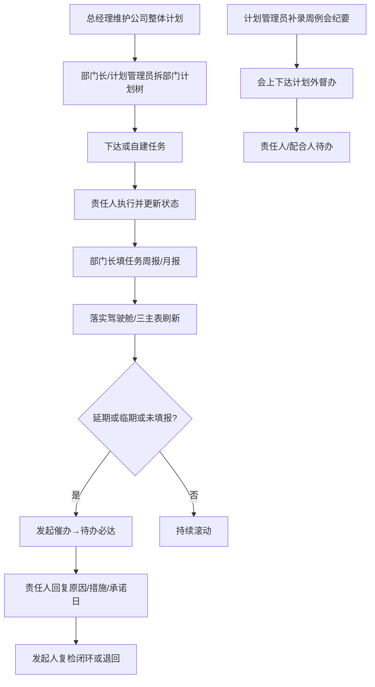
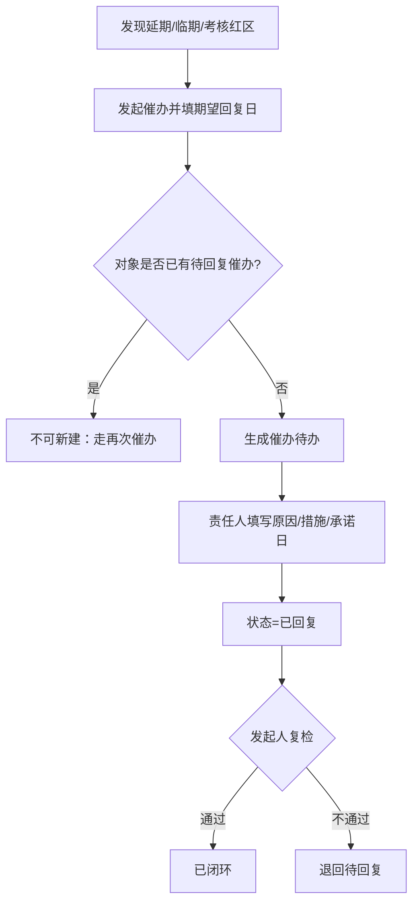
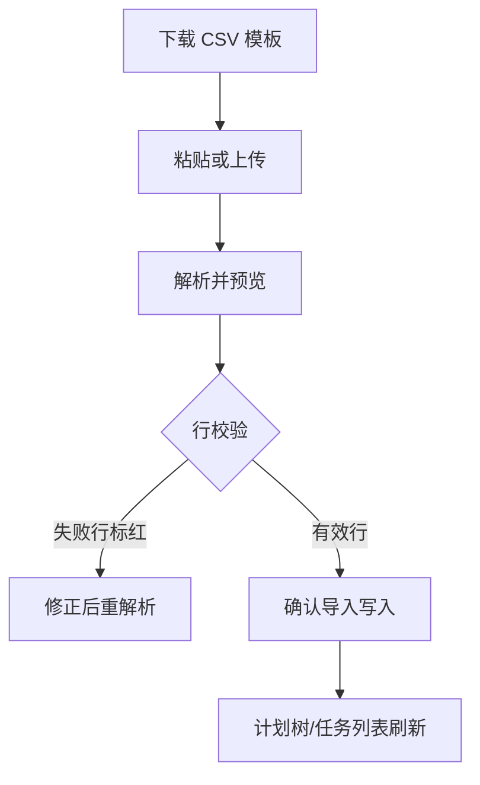

# 经营管理系统 PRD（V4.0.0）

| 项目 | 内容 |
| --- | --- |
| 产品名称 | 经营管理系统 |
| 当前版本 | v4.0.0 |
| 版本更新时间 | 2026-10-16 |
| 版本迭代说明 | 按 PC 原型回写：四角色；公司计划 + 无限层级部门计划树；落实驾驶舱 + 三主表；任务周/月报；任务督办（含周例会纪要）；导入；绩效考核；经营一表 |
| 文档状态 | 已按原型修订（本轮不生成 prd.html） |
| 范围说明 | [`scope.md`](./scope.md) |
| 原型入口 | [`prototype/versions/v4.0.0/index.html`](../../../prototype/versions/v4.0.0/index.html) |

---

## 目录

- [1. 产品概述](#1-产品概述)
- [2. 结论与范围](#2-结论与范围)
- [3. 业务流程](#3-业务流程)
- [4. 功能模块总览](#4-功能模块总览)
- [5. 用户交互路径](#5-用户交互路径)
- [6. 页面清单与跳转关系](#6-页面清单与跳转关系)
- [7. 字段与状态说明](#7-字段与状态说明)
- [8. 非功能性需求](#8-非功能性需求)
- [9. 风险项](#9-风险项)
- [10. 待确认](#10-待确认)

---

## 1. 产品概述

### 1.1 产品定位

面向码头运营公司的经营管理台：总经理下达公司整体计划，各部门在计划树中拆解并挂任务执行，用任务周报/月报做文本与附件复盘，用落实驾驶舱与催办/督办抓例外，用绩效考核看完成率。

消息、审批、角色权限配置由内部平台提供，本 PRD **不设计**对应页面；原型用顶部角色切换模拟。

### 1.2 产品目标

| 目标 | 说明 | 优先级 |
| --- | --- | --- |
| 真实可演 | 四部门 + 点名人员 + 真实计划/任务种子可演示 | P0 |
| 四角色隔离 | 总经理 / 计划管理员 / 部门长 / 员工菜单与数据范围不同 | P0 |
| 计划树可拆 | 公司计划 → 部门无限层级计划树；责任人可跨部门、可设配合人 | P0 |
| 执行可跟 | 计划任务 + 临时任务；起止日必填；工时按日历天×8 自动算 | P0 |
| 例外可抓 | 驾驶舱红黄灯 + 催办闭环 + 计划外督办 | P0 |
| 闭环可读 | 周/月报、绩效考核、经营一表合成视图 | P0 |

### 1.3 用户角色

| 角色 | 人员（演示） | 核心诉求 | 优先级 |
| --- | --- | --- | --- |
| 总经理 | 李家治 | 驾驶舱抓例外；三主表联查；周月报/考核/督办催办 | P0 |
| 计划管理员 | 张凯（公司） | 计划总控/任务总控（含导入）；周例会纪要；督办协同 | P0 |
| 部门长 | 刘伟松、解运富、洪佳伟、钱旦 | 本部门计划拆解、任务下达、周月报填写、回复催办 | P0 |
| 员工 | 余彪、盛侨、陈子龙、张凯（市场） | 执行任务、查看本部门计划、只读周月报 | P0 |

### 1.4 核心对象关系

```
公司整体计划（公司计划表）
  └─ 部门计划树（无限层级，parentId；挂 companyPlanId）
       └─ 工作任务（计划任务：关联某计划节点；或临时任务：无关联）
每人×公司计划×周期：
  └─ 任务周报 / 任务月报（上期计划回显 + 完成 + 本期计划 + 附件）
任务督办（计划外事项；原周例会待办并入）
公司周例会纪要（一周一条；仅计划管理员维护）
催办（待回复 → 已回复 → 已闭环 / 可退回再催）
工作台待办（系统按义务生成）
```

---

## 2. 结论与范围

### 2.1 结论前置

本版以 **落实驾驶舱 + 公司计划表 / 部门计划表 / 整体任务表** 为经营主路径；计划模型为**树**而非年/月/周实体；周例会能力并入 **任务督办（会后督办 + 周例会纪要）**；绩效考核与经营一表本版均为 **P0**。

### 2.2 包含范围（In Scope）

| 模块 | 说明 | 优先级 |
| --- | --- | --- |
| 落实驾驶舱 | KPI、重点任务红黄灯、催办篮子、完成度 | P0 |
| 我的待办 | 模块列表 + 全局日历；临期=3天 | P0 |
| 公司计划表 | 下达/维护公司目标、整体进度手填 | P0 |
| 部门计划表 | 四部门计划树联查（只读视角） | P0 |
| 整体任务表 | 全量任务监督与催办 | P0 |
| 计划管理 / 计划总控 | 树编辑；详情弹窗；导入计划 | P0 |
| 任务管理 / 任务总控 | 下达/自建；计划/临时；导入任务 | P0 |
| 任务周报 / 任务月报 | 按公司计划填写；附件预览 | P0 |
| 任务督办 | 会上可下达督办；会后补纪要 | P0 |
| 绩效考核 | 部门/人员维度；红区置顶；催办 | P0 |
| 经营一表 | L1→L2→L3 合成展开 | P0 |
| 数据分析 | 按需分析入口（原宏观一表） | P0 |

### 2.3 不包含

年/月/周计划实体；日计划；综合/财务/智慧港口演示；何满生账号；经营数字结构化指标引擎；消息中心/审批/权限配置页。

### 2.4 三类场景

| 类型 | 要点 |
| --- | --- |
| 正常 | 总经理维护公司计划 → 部门长/计划管理员拆计划树 → 下达任务 → 部门长填周/月报 → 驾驶舱看例外 → 催办回复闭环；会上直接下达督办，会后计划管理员补纪要 |
| 边界 | 临时任务可不挂计划；督办可不先有纪要；经营一表非日用主入口但仍可全量展开；跨部门仅作配合人或任务责任人时按字段可见 |
| 异常 | 删计划须无子节点且无关联任务；催办对象已有「待回复」时不可重复新建（可再次催办）；导入行校验失败仅写入有效行；催办失败保留站内待办可重试 |

---

## 3. 业务流程

### 3.1 主流程



**解读：** 计划自上而下挂树；任务与周月报并行；催办与督办分别覆盖「计划内例外」与「计划外事项」。

### 3.2 催办闭环子流程



**解读：** 催办站内待办必达；同一对象同时仅一条「待回复」主催办。

### 3.3 导入子流程



**解读：** 计划管理员在计划总控/任务总控内进入导入；仅确认有效行落库。

---

## 4. 功能模块总览

### 4.1 角色菜单

| 角色 | 菜单分组 | 菜单项 |
| --- | --- | --- |
| 总经理 | 工作台 | 落实驾驶舱 |
| 总经理 | 经营主表 | 公司计划表；部门计划表；整体任务表 |
| 总经理 | 经营闭环 | 任务周报；任务月报；绩效考核；任务督办 |
| 总经理 | 更多（按需） | 经营一表（合成）；计划管理；数据分析 |
| 计划管理员 | 工作台 | 计划总控；任务总控 |
| 计划管理员 | 联查（只读） | 公司计划表；部门计划表；整体任务表 |
| 计划管理员 | 协同 | 任务督办；我的待办 |
| 部门长 | 工作台 | 我的待办 |
| 部门长 | 本部门 | 计划管理；任务管理 |
| 部门长 | 填报 | 任务周报；任务月报；任务督办 |
| 员工 | 工作台 | 我的待办 |
| 员工 | 执行 | 计划管理；任务管理 |
| 员工 | 查看 | 任务周报；任务月报（只读） |

### 4.2 模块说明（摘要）

| 模块 | 关键规则 | 优先级 |
| --- | --- | --- |
| 落实驾驶舱 | 日清作战台；重点任务=延期+临期+P0进行中；催办分桶 | P0 |
| 公司计划表 | 公司目标；整体进度%手填；起止日 | P0 |
| 部门计划表 | 树形只读联查；进度手填；延期=结束日已过且进度&lt;100 自动 | P0 |
| 整体任务表 | 全公司任务；支持催办 | P0 |
| 计划管理 | 无限层级；负责人可跨部门；配合人多人；有子节点/关联任务不可删 | P0 |
| 任务管理 | 来源：下达/自建；类型：计划/临时；工时=(结束-开始+1)×8 | P0 |
| 导入 | 部门计划列、任务列固定模板；预览后写入 | P0 |
| 任务周报/月报 | 维度：用户×公司计划×周期；部门长可编失焦保存；总经/员工只读 | P0 |
| 任务督办 | 计划外；挂当前自然周；会上可先下达；纪要仅计划管理员 | P0 |
| 催办 | 待回复→已回复→已闭环；须期望回复日；可再次催办/退回 | P0 |
| 绩效考核 | 任务完成率=(已完成+已关闭)/总数；有延期红区置顶 | P0 |
| 经营一表 | L1公司→L2部门计划→L3任务合成；可筛仅问题 | P0 |
| 我的待办 | 类型含周报/月报/任务/督办/催办回复等；临期3天 | P0 |

### 4.3 数据权限（原型口径）

| 能力 | 总经理 | 计划管理员 | 部门长 | 员工 |
| --- | --- | --- | --- | --- |
| 全量浏览计划树 | 是（只读为主） | 是（可编） | 本部门 | 本部门可见执行相关 |
| 编辑部门计划 | 否（公司计划可维） | 全量 | 本部门 | 否 |
| 下达/维护任务 | 督办/催办为主 | 全量总控 | 本部门 | 本人任务 |
| 填写周/月报 | 只读汇总 | — | 可编本人 | 只读 |
| 维护周例会纪要 | 否 | 是 | 否 | 否 |

---

## 5. 用户交互路径

| 编号 | 角色 | 路径 | 预期 | 优先级 |
| --- | --- | --- | --- | --- |
| UF-01 | 总经理 | 公司计划表 → 新建/维护公司目标与进度 | 各部门计划可挂接该公司计划 | P0 |
| UF-02 | 部门长 | 计划管理 → 拆子计划 → 任务管理下达 | 责任人出现任务与待办 | P0 |
| UF-03 | 计划管理员 | 计划总控/任务总控 → 导入 CSV | 有效行写入树或任务列表 | P0 |
| UF-04 | 部门长 | 我的待办 → 任务周报/月报提交 | 待办关闭；总经理周月报可见 | P0 |
| UF-05 | 总经理 | 落实驾驶舱 → 重点任务/催办 → 发起催办 | 对象待办新增「催办回复」 | P0 |
| UF-06 | 部门长 | 待办回复催办 → 总经理复检闭环 | 催办状态已闭环 | P0 |
| UF-07 | 总经理/部门长 | 任务督办 → 下达督办 | 责任人与配合人待办 | P0 |
| UF-08 | 计划管理员 | 任务督办 → 周例会纪要 Tab | 一周一条纪要+附件可维护 | P0 |
| UF-09 | 总经理 | 绩效考核 → 红区催办 / 经营一表展开例外 | 完成率与例外可下钻 | P0 |

---

## 6. 页面清单与跳转关系

| 页面 | 路径 | 主要角色 | 优先级 |
| --- | --- | --- | --- |
| 版本入口 | `prototype/versions/v4.0.0/index.html` | 全部 | P0 |
| 落实驾驶舱 | `pages/落实驾驶舱_page.html` | 总经理 | P0 |
| 我的待办 | `pages/工作台_待办_page.html` | 计划管理员/部门长/员工 | P0 |
| 公司计划表 | `pages/经营总台账_page.html` | 总经理；计划管理员联查 | P0 |
| 部门计划表 | `pages/部门计划表_page.html` | 总经理；计划管理员联查 | P0 |
| 整体任务表 | `pages/整体计划_任务监督_page.html` | 总经理；计划管理员联查 | P0 |
| 计划管理/计划总控 | `pages/计划管理_page.html` | 计划管理员/部门长/员工（权限不同） | P0 |
| 计划详情 | `pages/计划详情_page.html`（或弹窗） | 有计划浏览权角色 | P0 |
| 导入计划/任务 | `pages/计划导入_page.html` | 计划管理员（入口在总控内） | P0 |
| 任务管理/任务总控 | `pages/任务管理_page.html` | 计划管理员/部门长/员工 | P0 |
| 任务周报 | `pages/任务周报_page.html` | 总经理只读；部门长可编；员工只读 | P0 |
| 任务月报 | `pages/任务月报_page.html` | 同上 | P0 |
| 任务督办 | `pages/任务督办_page.html` | 总经理/计划管理员/部门长 | P0 |
| 绩效考核 | `pages/绩效考核_page.html` | 总经理 | P0 |
| 经营一表 | `pages/经营一表_page.html` | 总经理（按需） | P0 |
| 数据分析 | `pages/宏观一表_page.html` | 总经理（按需） | P0 |

侧栏按角色切换；页内弹窗完成新建/详情/催办/附件预览。计划管理员进入计划/任务页时标题显示「计划总控」「任务总控」。

**已并入/下线说明（相对旧稿）：**

| 旧能力 | 本版处理 |
| --- | --- |
| 独立「周例会待办」页 | 并入任务督办（督办事项种子含原例会待办） |
| 年/月/周计划页 | 取消实体；由部门计划树替代 |
| 宏观一表 | 更名为「数据分析」，保留按需入口 |
| 部门台账 / 任务下达 / 我的计划与任务等旧名 | 合并为计划管理、任务管理及三主表命名 |

---

## 7. 字段与状态说明

### 7.1 公司计划

| 字段 | 说明 | 必填 | 优先级 |
| --- | --- | --- | --- |
| 计划名称 | 公司整体目标名称 | 是 | P0 |
| 优先级 | P0/P1/P2 | 是 | P0 |
| 负责人 | 演示为总经理 | 是 | P0 |
| 开始/结束日期 | 目标起止 | 是 | P0 |
| 整体进度% | 手填 0–100 | 是 | P0 |
| 进展说明 | 文本 | 否 | P0 |
| 状态 | 进行中等；进度满则已完成 | 是 | P0 |

### 7.2 部门计划（树节点）

| 字段 | 说明 | 必填 | 优先级 |
| --- | --- | --- | --- |
| 计划名称 | 节点名称 | 是 | P0 |
| 归属部门 | 本部门归属 | 是 | P0 |
| 归属公司计划 | companyPlanId | 是 | P0 |
| 上级计划 | parentId，可空=根 | 否 | P0 |
| 优先级 | 默认可继承上级 | 是 | P0 |
| 负责人 | 可跨部门 | 是 | P0 |
| 配合人员 | 多人，不含负责人本人 | 否 | P0 |
| 开始/结束日期 | 结束日用于延期判断 | 是 | P0 |
| 进度% | 手填 0–100 | 是 | P0 |
| 进展说明 | 文本 | 否 | P0 |
| 状态 | 见 7.5 | 是 | P0 |

### 7.3 工作任务

| 字段 | 说明 | 必填 | 优先级 |
| --- | --- | --- | --- |
| 任务名称 | 文本 | 是 | P0 |
| 任务性质 | 计划 / 临时 | 是 | P0 |
| 关联计划 | 计划任务必填；临时可空 | 条件 | P0 |
| 责任人 | 人员 | 是 | P0 |
| 来源 | 下达 / 自建 | 是 | P0 |
| 优先级 | P0/P1/P2 | 是 | P0 |
| 任务类型 | 如生产作业/设备维保等 | 否 | P1 |
| 开始/结束日期 | 结束日同步逾期判断 | 是 | P0 |
| 耗费工时 | 自动：(结束−开始+1)×8 小时 | — | P0 |
| 状态 | 见 7.5 | 是 | P0 |
| 备注 / 附件 | 可选 | 否 | P1 |
| 父任务 | 支持子任务 | 否 | P1 |

### 7.4 任务周报 / 月报

| 字段 | 说明 | 必填 | 优先级 |
| --- | --- | --- | --- |
| 周期 | 周键如 2026-W34；月键如 2026-08 | 是 | P0 |
| 公司计划 | 每条公司计划一行 | 是 | P0 |
| 上期计划 | 上回显，只读 | — | P0 |
| 上期/本期完成情况 | 文本 | 是（关闭待办时） | P0 |
| 本期计划 | 文本 | 是（关闭待办时） | P0 |
| 附件 | 图片 / Word / PRD，可预览 | 否 | P1 |
| 进度% | 可选手填 | 否 | P1 |

### 7.5 任务督办与周例会纪要

**督办事项**

| 字段 | 说明 | 必填 | 优先级 |
| --- | --- | --- | --- |
| 督办事项 | 标题 | 是 | P0 |
| 周次 | 默认当前自然周 | 是 | P0 |
| 优先级 | P0/P1/P2 | 是 | P0 |
| 责任人 | 人员 | 是 | P0 |
| 配合人员 | 多人 | 否 | P0 |
| 开始/结束时间 | 用于逾期 | 是 | P0 |
| 下达人 | 创建人 | 是 | P0 |
| 状态 | 待办/进行中/已完成/延期 | 是 | P0 |
| 备注 | 文本 | 否 | P1 |

**周例会纪要**

| 字段 | 说明 | 必填 | 优先级 |
| --- | --- | --- | --- |
| 周次 | 一周一条 | 是 | P0 |
| 纪要概要 | 文本 | 是 | P0 |
| 附件 | 文件名列表 | 否 | P0 |
| 更新人/时间 | 仅计划管理员可写 | — | P0 |

### 7.6 催办

| 字段 | 说明 | 必填 | 优先级 |
| --- | --- | --- | --- |
| 催办对象 | 用户 | 是 | P0 |
| 标题 / 说明 | 文本 | 是 | P0 |
| 期望回复日 | 日期 | 是 | P0 |
| 关联任务/公司计划/部门 | 可选上下文 | 否 | P0 |
| 例外类型 | 如任务延期、任务临期 | 否 | P1 |
| 状态 | 待回复 / 已回复 / 已闭环 | 是 | P0 |
| 回复：原因 / 措施 / 承诺日 | 回复时必填 | 条件 | P0 |

### 7.7 状态规则

| 对象 | 状态/规则 |
| --- | --- |
| 部门计划 | 进度≥100→已完成；结束日已过且进度&lt;100→延期；其余保留手填（进行中/关注等） |
| 任务 | 未开始 / 进行中 / 已完成 / 已关闭 / 延期；未完成且结束日&lt;今天视为逾期 |
| 临期 | 未逾期且距结束日 ≤ 3 天 |
| 督办 | 待办 / 进行中 / 已完成 / 延期 |
| 催办 | 待回复 → 已回复 → 已闭环；已回复可退回为待回复 |
| 待办类型 | 任务周报、任务月报、任务、任务督办、督办配合、催办回复、催办复检等 |

### 7.8 导入模板列

| 模式 | 列 |
| --- | --- |
| 导入部门计划 | 归属公司计划、部门、上级计划、计划名称、优先级、负责人、开始日期、结束日期、进度、进展说明 |
| 导入任务 | 关联计划、任务名称、处理人、优先级、开始日期、结束日期、任务类型 |

---

## 8. 非功能性需求

| 项 | 要求 | 优先级 |
| --- | --- | --- |
| 端形态 | PC Web | P0 |
| 原型技术 | HTML + Tailwind CDN + 原生 JS | P0 |
| 数据 | 前端种子 + localStorage 演示持久；可角色切换 | P0 |
| 演示「今天」 | 种子固定如 2026-08-18，用于临期/逾期 | P0 |
| 权限页 | 不设计；角色切换模拟 | P0 |
| 附件 | 原型支持文件名与部分在线预览；正式环境对接文档服务 | P1 |

---

## 9. 风险项

| 风险 | 影响 | 缓解 | 优先级 |
| --- | --- | --- | --- |
| 计划树无限层级过深 | 联查与导入难读 | 部门计划表/经营一表提供展开层级控制；导入要求上级可解析 | P0 |
| 计划任务与临时任务/督办混淆 | 用户选错入口 | 文案区分：计划内走任务管理，计划外走督办 | P0 |
| 催办与任务待办重复打扰 | 体验嘈杂 | 任务已挂「待回复催办」时不再生成普通任务待办 | P0 |
| 周月报按公司计划多行 | 填写负担 | 待办提示缺口数；失焦自动保存 | P1 |
| 经营一表信息过载 | 日用不适 | 定位为按需合成；日常强制引导驾驶舱+三主表 | P1 |
| 工时按日历天×8 | 与真实工时偏差 | PRD 标明为口径规则；后续可改人天/手工 | P1 |

---

## 10. 待确认

| 编号 | 事项 | 默认（未确认前按此） | 优先级 |
| --- | --- | --- | --- |
| T1 | 员工是否允许自建临时任务 | 允许（原型已有自建临时） | P0 |
| T2 | 总经理是否可编辑部门计划树 | 否，只读联查+公司计划维护 | P0 |
| T3 | 周报填写人范围是否扩展到员工 | 本版仅部门长可编，员工只读 | P0 |
| T4 | 督办是否允许关联公司计划 | 否，保持计划外 | P1 |
| T5 | 数据分析页指标口径是否与驾驶舱完全一致 | 保持现网原型口径，不强制统一 | P1 |

---

**文档结束（v4.0.0 · 2026-10-16 按原型修订）**
