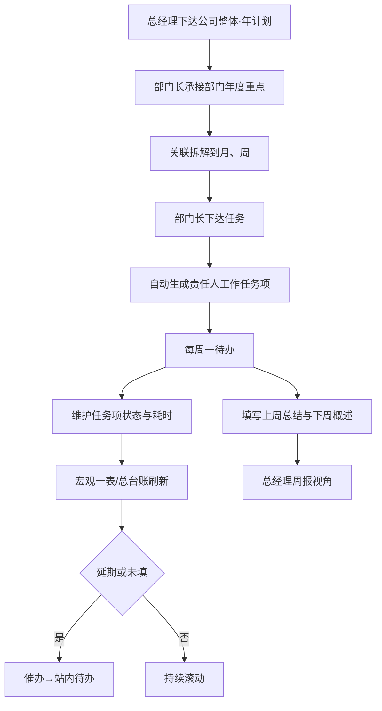
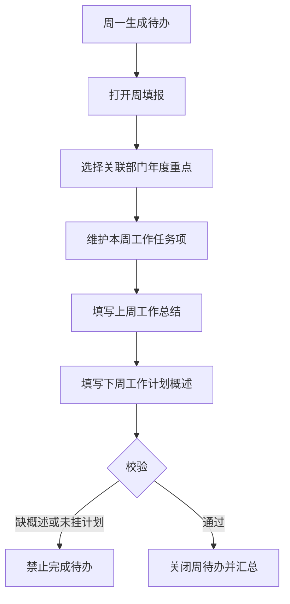

# 经营管理系统 PRD（V4.0.0）

| 项目 | 内容 |
| --- | --- |
| 产品名称 | 经营管理系统 |
| 当前版本 | v4.0.0 |
| 版本更新时间 | 2026-10-08 |
| 版本迭代说明 | 独立新版：计划双维（年→月→周 × 公司→部门）；任务双维（周任务项+文本概述）；三角色 PC 台；宏观 Excel 多列表；真实四部门种子数据 |
| 文档状态 | 已确认 PC 端原型 |
| 范围说明 | [`scope.md`](./scope.md) |

---

## 目录

- [1. 产品概述](#1-产品概述)
- [2. 结论与范围](#2-结论与范围)
- [3. 业务流程](#3-业务流程)
- [4. 功能模块总览](#4-功能模块总览)
- [5. 用户交互路径](#5-用户交互路径)
- [6. 页面清单与跳转关系](#6-页面清单与跳转关系)
- [7. 字段与状态说明](#7-字段与状态说明)
- [8. 非功能性需求](#8-非功能性需求)
- [9. 风险项](#9-风险项)
- [10. 待确认](#10-待确认)

---

## 1. 产品概述

### 1.1 产品定位

面向码头运营公司的经营管理台：把公司整体计划拆到部门年/月/周，用结构化周任务项做数量/状态/耗时跟踪，用文本完成上周总结与下周概述，供总经理宏观监督与催办。

消息、审批、角色权限配置由内部平台提供，本 PRD **不设计**对应页面。

### 1.2 产品目标

| 目标 | 说明 | 优先级 |
| --- | --- | --- |
| 真实可演 | 四部门+点名人员+真实计划种子可演示 | P0 |
| 三角色隔离 | 总经理 / 部门长 / 员工菜单与数据范围不同 | P0 |
| 双维计划 | 时间年→月→周；组织公司→部门，关联展示 | P0 |
| 双维任务 | 结构化任务项统计 + 文本周概述 | P0 |
| 宏观可读 | Excel 多列表，默认部门×月 | P0 |

### 1.3 用户角色

| 角色 | 人员（演示） | 核心诉求 | 优先级 |
| --- | --- | --- | --- |
| 总经理 | 李家治 | 总台账、监督催办、宏观一表、周报 | P0 |
| 部门长 | 刘伟松、解运富、洪佳伟、钱旦 | 部门台账、派任务、周填+月填 | P0 |
| 员工 | 余彪、盛侨、陈子龙、张凯 | 看计划/任务、周填报 | P0 |

### 1.4 核心对象关系

```
公司整体计划
  └─ 部门年度重点工作
       ├─ 年 / 月 / 周工作计划条目（关联）
       └─ 下达任务 → 自动生成责任人「工作任务项」
每人每周：
  ├─ 工作任务项（结构化：状态、耗时小时整数）
  └─ 文本：上周工作总结 + 下周工作计划概述
周例会待办（独立对象）
工作台待办（系统按义务生成）
```

---

## 2. 结论与范围

### 2.1 结论前置

本版只做四部门经营管理闭环与总经理监督；宏观视图为多列表格；不做日计划与结构化经营指标引擎。

### 2.2 包含范围（In Scope）

| 模块 | 说明 | 优先级 |
| --- | --- | --- |
| 工作台待办 | 周一周填报；月末/月初月填报；任务/催办/例会待办 | P0 |
| 经营总台账 | 公司整体计划下达与完成、关联任务 | P0 |
| 任务监督 | 延期统计、催办（站内待办必达） | P0 |
| 宏观一表 | 多列；默认部门×月；未拆月不展示 | P0 |
| 周报视角 | 文本汇总 + 任务项统计 | P0 |
| 部门台账 / 任务下达 | 本部门人 + 关联计划部门长 | P0 |
| 周填报 / 月填报 | 任务项+概述；部门长月文本 | P0 |
| 年/月/周计划与年度重点 | 三级都做 | P0 |
| 周例会待办 | 独立对象 | P0 |

### 2.3 不包含

日计划；综合/财务/智慧港口演示；何满生账号；经营数字结构化字段；消息中心/审批/权限配置页；树形图。

### 2.4 三类场景

| 类型 | 要点 |
| --- | --- |
| 正常 | 总经理下达公司年计划 → 部门长承接年度重点并拆月周 → 下达任务自动生成任务项 → 周一填总结/概述/任务项 → 宏观表与周报刷新 |
| 边界 | 无任务项仅有概述允许提交（任务数 0）；跨部门只派到对方部门长 |
| 异常 | 周填未挂年度重点禁止提交；耗时非整数拦截；催办失败保留站内待办可重试 |

---

## 3. 业务流程

### 3.1 主流程



**解读：** 计划自上而下关联；任务项与文本概述并行；监督催办闭合。

### 3.2 周填报子流程



---

## 4. 功能模块总览

### 4.1 角色菜单

| 角色 | 菜单 |
| --- | --- |
| 总经理 | 工作台；经营总台账；整体计划与任务监督；宏观一表；周报视角；周例会待办；部门年度重点（只读） |
| 部门长 | 工作台；部门台账；任务下达；我的计划与任务；周填报；月填报；部门年度重点；周例会待办 |
| 员工 | 工作台；我的计划与任务；周填报 |

### 4.2 模块说明（摘要）

| 模块 | 关键规则 | 优先级 |
| --- | --- | --- |
| 经营总台账 | 下达公司整体计划；看完成文本与关联任务项状态 | P0 |
| 宏观一表 | 列含公司计划、部门、年/月/周、完成情况、计划状态、任务数分列、责任人；默认部门×月 | P0 |
| 周报视角 | 各部门上周总结、下周概述；任务项数量/状态/耗时汇总 | P0 |
| 任务下达 | 挂计划；派本部门任意人 or 关联计划部门的部门长；自动生成任务项 | P0 |
| 工作任务项 | 本人录入或下达生成；状态跟踪；耗时整数小时 | P0 |
| 文本概述 | 上周工作总结 + 下周工作计划概述（下一自然周） | P0 |
| 月填报 | 部门长：月完成情况 + 本月计划内容（文本） | P0 |
| 周例会待办 | 独立对象，不并入普通任务类型 | P0 |
| 催办 | 系统内待办必达；有企微则同步（原型模拟站内） | P0 |

---

## 5. 用户交互路径

| 编号 | 角色 | 路径 | 预期 |
| --- | --- | --- | --- |
| UF-01 | 总经理 | 经营总台账 → 下达公司年计划 → 指定责任部门 | 部门长待办/台账可见承接 |
| UF-02 | 部门长 | 部门年度重点 → 拆月/周 → 任务下达给员工或关联部门长 | 对方出现任务项 |
| UF-03 | 员工 | 工作台周待办 → 周填报提交 | 待办关闭；周报可见 |
| UF-04 | 总经理 | 宏观一表切换部门×月 → 看延期 → 催办 | 被催办人待办新增 |
| UF-05 | 部门长 | 月填报提交本月完成与下月计划 | 总台账月维度可阅 |

---

## 6. 页面清单与跳转关系

| 页面 | 路径 | 角色 | 优先级 |
| --- | --- | --- | --- |
| 版本入口 | `prototype/versions/v4.0.0/index.html` | 全部 | P0 |
| 工作台待办 | `pages/工作台_待办_page.html` | 全部 | P0 |
| 经营总台账 | `pages/经营总台账_page.html` | 总经理 | P0 |
| 整体计划与任务监督 | `pages/整体计划_任务监督_page.html` | 总经理 | P0 |
| 宏观一表 | `pages/宏观一表_page.html` | 总经理 | P0 |
| 周报视角 | `pages/周报视角_page.html` | 总经理 | P0 |
| 部门台账 | `pages/部门台账_page.html` | 部门长 | P0 |
| 任务下达 | `pages/任务下达_page.html` | 部门长 | P0 |
| 我的计划与任务 | `pages/我的计划与任务_page.html` | 部门长/员工 | P0 |
| 周填报 | `pages/周填报_page.html` | 部门长/员工 | P0 |
| 月填报 | `pages/月填报_page.html` | 部门长 | P0 |
| 部门年度重点 | `pages/部门年度重点_page.html` | 部门长写/总经理读 | P0 |
| 周例会待办 | `pages/周例会待办_page.html` | 总经理/部门长 | P0 |

侧栏按角色切换；页内弹窗完成新建/详情/催办。

---

## 7. 字段与状态说明

### 7.1 工作任务项

| 字段 | 说明 | 必填 | 优先级 |
| --- | --- | --- | --- |
| 任务名称 | 文本 | 是 | P0 |
| 关联计划 | 部门年度重点或年/月/周条目 | 是 | P0 |
| 责任人 | 人员 | 是 | P0 |
| 状态 | 未开始/进行中/已完成/延期 | 是 | P0 |
| 计划耗时 | 整数小时 | 否 | P1 |
| 实际耗时 | 整数小时 | 否 | P0 |
| 所属周 | 周次 | 是 | P0 |

### 7.2 周填报文本

| 字段 | 说明 | 必填 |
| --- | --- | --- |
| 上周工作总结 | 文本 | 是 |
| 下周工作计划概述 | 文本（下一自然周） | 是 |
| 关联部门年度重点 | 至少一条 | 是 |

### 7.3 计划状态

| 状态 | 规则 |
| --- | --- |
| 正常 | 未到期且无延期标记 |
| 临期 | 3 日内到期 |
| 延期 | 过截止或人工标延期 |
| 已完成 | 完成情况标明完成 |

---

## 8. 非功能性需求

| 项 | 要求 | 优先级 |
| --- | --- | --- |
| 端形态 | PC Web | P0 |
| 原型技术 | HTML + Tailwind CDN + 原生 JS | P0 |
| 数据 | 前端种子数据，可角色切换 | P0 |
| 权限页 | 不设计；原型用角色切换模拟 | P0 |

---

## 9. 风险项

| 风险 | 影响 | 缓解 | 优先级 |
| --- | --- | --- | --- |
| 下达任务与自建任务项混淆 | 用户不清 | 界面标注来源：下达/自建 | P0 |
| 种子过滤后周表示例变少 | 演示单薄 | 为点名人员补齐映射条目 | P0 |
| 宏观列过多 | 难读 | 默认部门×月，支持隐藏列 | P1 |

---

## 10. 待确认

| 编号 | 事项 | 默认 |
| --- | --- | --- |
| — | 本版关键决策已全部确认 | 见 scope 修订记录 |

---

**文档结束（v4.0.0）**
