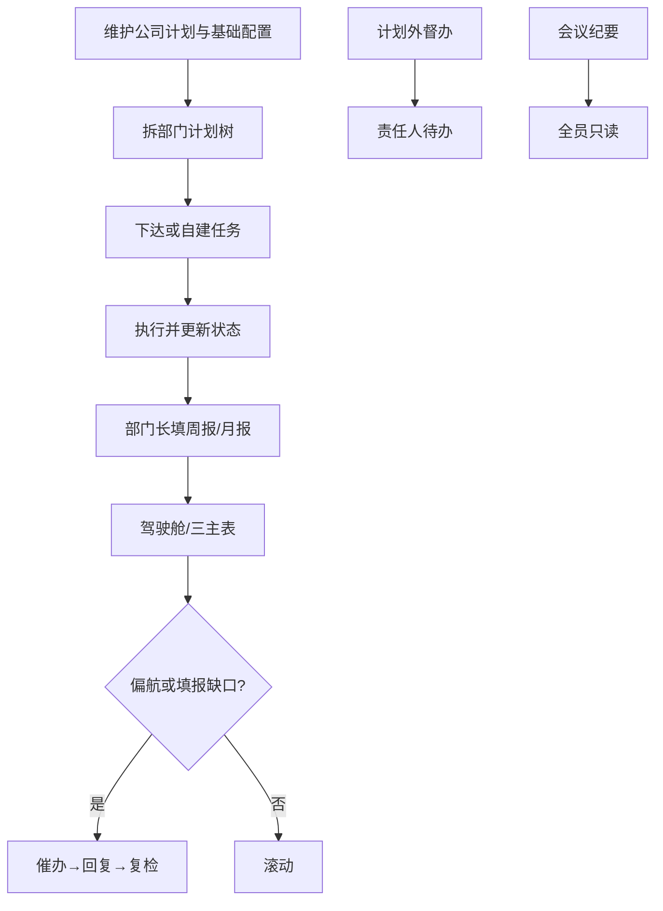
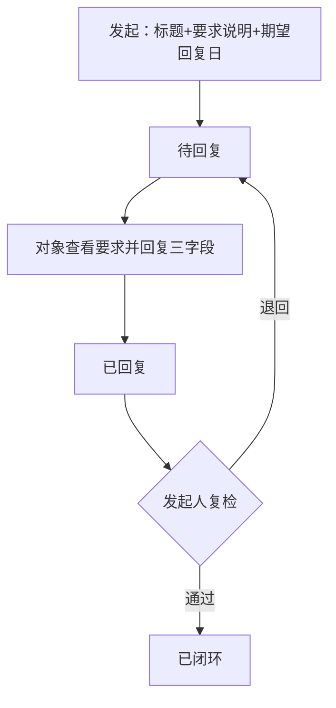

# 经营管理系统 PRD（V4.0.0）

| 项目 | 内容 |
| --- | --- |
| 产品名称 | 经营管理系统 |
| 当前版本 | v4.0.0 |
| 版本更新时间 | 2026-10-21 |
| 版本迭代说明 | 按最新原型回写：待办模块/紧急度/KPI；计划行内编辑；任务树平铺；导入 CSV 列 |
| 文档状态 | **已锁定（研发事实源）**；阅读页见 [`prd.html`](./prd.html) |
| 范围说明 | [`scope.md`](./scope.md) |
| 原型入口 | [`prototype/versions/v4.0.0/index.html`](../../../prototype/versions/v4.0.0/index.html) |

### 文档约定

| 约定 | 说明 |
| --- | --- |
| 本期对齐 | **以 v4.0.0 原型菜单与交互为准**回写本文；研发/测试按本文验收 |
| 后续变更 | 先改 PRD 再改实现；禁止静默以原型扩需求 |
| 非菜单页 | 仓库内遗留 HTML（如经营一表、宏观一表、旧周月报页等）**不在交付范围**，不验收 |

---

## 目录

- [1. 产品概述](#1-产品概述)
  - [1.1 产品定位](#11-产品定位)
  - [1.2 产品目标](#12-产品目标)
  - [1.3 用户角色](#13-用户角色)
  - [1.4 核心对象关系](#14-核心对象关系)
- [2. 结论与范围](#2-结论与范围)
  - [2.1 结论前置](#21-结论前置)
  - [2.2 本期范围](#22-本期范围)
  - [2.3 二期范围](#23-二期范围)
  - [2.4 不在范围](#24-不在范围)
  - [2.5 场景分类](#25-场景分类)
- [3. 业务流程](#3-业务流程)
  - [3.1 主流程](#31-主流程)
  - [3.2 催办闭环流程](#32-催办闭环流程)
- [4. 功能说明](#4-功能说明)
  - [4.1 角色与菜单](#41-角色与菜单)
  - [4.2 数据权限](#42-数据权限)
  - [4.3 编写约定](#43-编写约定)
  - [4.4 落实驾驶舱](#44-落实驾驶舱)
  - [4.5 我的待办](#45-我的待办)
  - [4.6 公司计划表](#46-公司计划表)
  - [4.7 部门计划表](#47-部门计划表)
  - [4.8 整体任务表](#48-整体任务表)
  - [4.9 计划管理](#49-计划管理)
  - [4.10 任务管理](#410-任务管理)
  - [4.11 计划导入与任务导入](#411-计划导入与任务导入)
  - [4.12 任务周报](#412-任务周报)
  - [4.13 任务月报](#413-任务月报)
  - [4.14 任务督办](#414-任务督办)
  - [4.15 会议纪要](#415-会议纪要)
  - [4.16 绩效考核](#416-绩效考核)
  - [4.17 基础配置](#417-基础配置)
- [5. 用户路径](#5-用户路径)
- [6. 页面清单](#6-页面清单)
- [7. 数据字典](#7-数据字典)
  - [7.1 公司计划](#71-公司计划)
  - [7.2 部门计划](#72-部门计划)
  - [7.3 任务](#73-任务)
  - [7.4 周期报](#74-周期报)
  - [7.5 督办与会议纪要](#75-督办与会议纪要)
  - [7.6 催办](#76-催办)
  - [7.7 基础配置](#77-基础配置)
  - [7.8 状态规则](#78-状态规则)
- [8. 研发说明](#8-研发说明)
  - [8.1 实体关系](#81-实体关系)
  - [8.2 接口能力](#82-接口能力)
  - [8.3 验收要点](#83-验收要点)
- [9. 非功能需求](#9-非功能需求)
- [10. 风险](#10-风险)
- [11. 待确认](#11-待确认)

---

## 1. 产品概述

### 1.1 产品定位

码头运营公司经营管理台：公司计划下达 → 部门计划树拆解 → 任务执行 → 周/月报复盘 → 驾驶舱与催办抓偏航 → 督办/纪要/考核闭环。

消息、审批、角色权限配置由内部平台提供；原型用顶部角色切换模拟。

### 1.2 产品目标

| 目标 | 优先级 |
| --- | --- |
| 四部门 + 点名人员种子可演示 | P0 |
| 四角色菜单与数据范围隔离；计划管理员=全菜单管理员 | P0 |
| 公司计划 → 无限层级部门计划树；任务起止必填；工时按日历天×8 | P0 |
| 驾驶舱汇总可下钻；催办闭环；临期读基础配置 | P0 |
| 企微提醒推送引擎 | P1 |

### 1.3 用户角色

| 角色 | 人员（演示） | 核心能力 |
| --- | --- | --- |
| 总经理 | 李家治 | 驾驶舱、三主表、闭环查阅、催办、基础配置 |
| 计划管理员 | 张凯（公司） | 全菜单：计划管理/任务管理（页内导入入口）+三主表+驾驶舱+闭环+基础配置；纪要可写 |
| 部门长 | 刘伟松、解运富、洪佳伟、钱旦 | 本部门计划/任务、周月报填写、督办、回复催办；纪要只读 |
| 员工 | 余彪、盛侨、陈子龙、张凯（市场） | 本部门计划可见、任务执行、自建临时任务；周月报/纪要只读 |

### 1.4 核心对象关系

```
公司计划
  └─ 部门计划树（parentId；挂 companyPlanId）
       └─ 工作任务（计划任务挂节点 / 临时任务可空）
周期报：用户 × 公司计划 × 周|月
催办 / 督办 / 会议纪要 / 待办 / 基础配置（nearDueDays 等）
```

---

## 2. 结论与范围

### 2.1 结论前置

本期交付范围 = **原型侧栏可见菜单对应能力**。三主表汇总卡 = 合计 + 分状态；催办须要求说明可见并闭环；临期天数读 `nearDueDays`。

### 2.2 本期范围

| 模块 | 说明 | 详见 |
| --- | --- | --- |
| 落实驾驶舱 | 汇总下钻、重点任务、催办篮子、过程盯控、部门完成度 | §4.4 |
| 我的待办 | KPI+填报中心/任务执行/计划协同/任务督办/催办往来；紧急度；近7日已办；日历；催办闭环 | §4.5 |
| 公司 / 部门 / 整体任务表 | 汇总卡 + 筛选；公司计划可行内编辑 | §4.6–§4.8 |
| 计划管理 | 同页同名；树维护；详情为大弹窗；按角色控数据与可编 | §4.9 |
| 任务管理 | 同页同名；计划/临时；下达/自建；按角色控数据与可编 | §4.10 |
| 计划导入 / 任务导入 | 非侧栏菜单；入口在计划管理/任务管理页；CSV 模板→预览→写入 | §4.11 |
| 任务周报 / 月报 | 部门长可编 | §4.12–§4.13 |
| 任务督办 / 会议纪要 / 绩效考核 | 见权限矩阵 | §4.14–§4.16 |
| 催办 | 发起→回复→复检闭环 | §7.6 |
| 基础配置 | 周报日、月报日、临期天数 | §4.17；§7.7 |


### 2.3 二期范围

| 模块 | 说明 | 优先级 |
| --- | --- | --- |
| 提醒推送引擎 | 按配置触发；渠道 **企业微信**（可同步站内待办） | P1 |

### 2.4 不在范围

| 项 |
| --- |
| 经营一表、数据分析（宏观一表） |
| 公司计划×部门贡献矩阵 |
| 年/月/周计划实体、日计划 |
| 独立例外清单、重点任务红黄灯 |
| 消息中心 / 审批流 / 权限配置页 |
| 综合管理部、资金财务部、智慧港口演示组织 |

### 2.5 场景分类

| 类型 | 要点 |
| --- | --- |
| 正常 | 配基础配置 → 维护公司计划 → 拆树下达任务 → 填周月报 → 驾驶舱催办 → 对象回复 → 发起人复检闭环 |
| 边界 | 临时任务可不挂计划；筛选后汇总与列表同源；再次催办追加说明历史 |
| 异常 | 有子节点/关联任务不可删计划；待回复催办不可重复新建；配置数值钳制 |

---

## 3. 业务流程

### 3.1 主流程



### 3.2 催办闭环流程



---

## 4. 功能说明

### 4.1 角色与菜单

| 角色 | 分组 | 菜单项 |
| --- | --- | --- |
| 总经理 | 工作台 | 落实驾驶舱 |
| 总经理 | 经营主表 | 公司计划表；部门计划表；整体任务表 |
| 总经理 | 经营闭环 | 任务周报；任务月报；绩效考核；任务督办；会议纪要 |
| 总经理 | 系统 | 基础配置 |
| 计划管理员 | 工作台 | 落实驾驶舱；我的待办 |
| 计划管理员 | 计划任务 | 计划管理；任务管理；基础配置（导入见页内入口，非侧栏） |
| 计划管理员 | 经营主表 | 公司计划表；部门计划表；整体任务表 |
| 计划管理员 | 经营闭环 | 任务周报；任务月报；绩效考核；任务督办；会议纪要 |
| 部门长 | 工作台 | 我的待办 |
| 部门长 | 本部门 | 计划管理；任务管理 |
| 部门长 | 填报 | 任务周报；任务月报；任务督办 |
| 部门长 | 查看 | 会议纪要（只读） |
| 员工 | 工作台 | 我的待办 |
| 员工 | 执行 | 计划管理；任务管理 |
| 员工 | 查看 | 任务周报；任务月报；会议纪要（只读） |

### 4.2 数据权限

| 能力 | 总经理 | 计划管理员 | 部门长 | 员工 |
| --- | --- | --- | --- | --- |
| 驾驶舱 / 考核 / 基础配置 | 是 | 是 | 否 | 否 |
| 维护公司计划 | 是 | 是 | 否 | 否 |
| 编辑部门计划树 | 否 | 全量 | 本部门 | 否（只读） |
| 任务 | 催办为主 | 全量可编 | 本部门 | 本人；可自建临时 |
| 周/月报 | 只读 | 只读 | 可编本人 | 只读 |
| 会议纪要 | 只读 | **可写** | 只读 | 只读 |

### 4.3 编写约定

| 项 | 说明 |
| --- | --- |
| 页面节结构 | 每页：概述 → 权限 → 字段 → 交互 → 筛选 → 弹窗 |
| 优先级 | 功能点标注 P0/P1/P2；未标默认 P0 |
| 计划详情 | **非独立菜单页**，一律大弹窗；权限随入口页 |
| 同页同名 | 计划管理、任务管理等跨角色统一菜单名；功能与数据范围由权限控制，禁止角色别名 |
| 管理员 | 文中「管理员」= 总经理 ∪ 计划管理员（`isAdmin`） |

---

### 4.4 落实驾驶舱

**原型：** `落实驾驶舱_page.html`　**优先级：** P0

#### 概述

管理员偏航盯控台：①偏航汇总卡 ②重点任务 + 催办篮子 ③周例会/督办 + 填报盯控 ④部门计划完成度。汇总可下钻；可发起/再次催办。

**日期：** `today` = 东八区服务器日（演示可固定）；`nearDueDays` = 基础配置（1–30，默认 3），临期判断即时读配置。

#### 权限

| 角色 | 可见 | 可操作 |
| --- | --- | --- |
| 总经理 / 计划管理员 | 是 | 下钻、催办、再次催办、周次切换 |
| 部门长 / 员工 | 否（门禁提示去待办） | — |

#### 字段 / 展示区

| 区域 | 内容 |
| --- | --- |
| 汇总卡 | 计划：延期/关注/催办待回复；任务：逾期/临期/催办待回复；主数字+P0/P1/P2 分段 |
| 重点任务 | 未闭环且（逾期∨临期∨(P0∧进行中)）；优先级色标；可催办 |
| 催办篮子 | 三桶：已超时 / 待回复 / 已闭环 |
| 过程盯控 | meetWeek；周例会状态；该周未闭环督办；填报缺口 |
| 部门完成度 | 各部门一级计划 `round(avg(progressPct))` |

#### 判定规则

| 规则名 | 说明 |
| --- | --- |
| resolvePlanStatus | ① progressPct≥100→已完成；② endDate&lt;today 且进度&lt;100→延期；③ 否则保留手填（含关注）；非法手填延期/已完成回落 |
| isTaskOverdue | 未闭环且（status=延期 或 endDate&lt;today） |
| isTaskNearDue | 未逾期未闭环，且 0≤(endDate−today)≤nearDueDays |
| urgeScope | planId 有且无 taskId→plan；有 taskId→task；否则 exceptionType 以「计划」开头→plan；其余→task |
| countByPrio | 合计+P0/P1/P2；缺省 priority 计 P2 |

#### 汇总卡口径

| 卡 ID | 公式 | 脚注 / 弹窗 |
| --- | --- | --- |
| plan_late | count(部门计划 resolve=延期) | P0/P1/P2 可点分段下钻 |
| plan_watch | count(resolve=关注) | 同上 |
| plan_urge | count(催办 待回复 ∧ scope=plan) | 提示其中期望日&lt;today 条数 |
| task_late | count(isTaskOverdue) | 可分段 |
| task_near | count(isTaskNearDue) | 脚注 P0 临期数 |
| task_urge | count(催办 待回复 ∧ scope=task) | 同 plan_urge |

点主数字→全量明细；点分段→仅该优先级；弹窗条数=卡面数字。计划卡不含公司计划实体。

| 用例 | 给定 | 期望 |
| --- | --- | --- |
| CK-01 | 部门计划过期且进度 80% | plan_late |
| CK-02 | 手填关注且未到期 | plan_watch |
| CK-03 | 结束日=today+nearDueDays | task_near 非 late |
| CK-04 | 催办仅 planId | plan_urge |
| CK-05 | 改 nearDueDays 刷新 | 临期集合变 |

#### 交互

| 操作 | 说明 | 优先级 |
| --- | --- | --- |
| 点汇总卡/分段 | 打开明细弹窗 | P0 |
| 重点任务/填报缺口「催办」 | 打开发起催办弹窗 | P0 |
| 篮子「再次催办」 | 追加说明历史，刷新期望日 | P0 |
| 切换 meetWeek | 刷新周例会、督办、填报盯控 | P0 |
| 篮子「复检」 | 本页保留复检弹窗（双入口）；**主路径仍建议走我的待办** | P0 |

#### 筛选

| 筛选项 | 说明 |
| --- | --- |
| 周次 meetWeek | 过程盯控区块；汇总卡/重点任务不受周次裁剪（全量偏航） |

#### 弹窗

| 弹窗 | 字段/动作 |
| --- | --- |
| 汇总明细 | 列表=卡口径；关闭不改数据 |
| 发起/再次催办 | 标题、要求说明(note)、期望回复日；确认后对象得「催办回复」待办 |
| 催办复检 | 与待办复检同能力；通过→已闭环；退回→待回复 |

**催办篮子过滤：** 已超时=待回复∧期望日&lt;today；待回复=待回复∧期望日≥today；已闭环=已闭环。待回复全集=plan_urge+task_urge。

**填报缺口：** 每部门长 × 每公司计划，无周期报或 planText/doneText 空 → 缺口；周用 meetWeek，月用 monthFromWeek(meetWeek)。

---

### 4.5 我的待办

**原型：** `工作台_待办_page.html`　**优先级：** P0

#### 概述

个人工作台：顶栏 KPI + 业务模块侧栏 + 紧急度分段列表 + 「近 7 日已办」；可切全局日历。催办回复与发起人复检闭环主入口。临期判定读 `nearDueDays`（与驾驶舱同源）。

#### 权限

| 角色 | 可见 | 数据范围 |
| --- | --- | --- |
| 计划管理员 / 部门长 / 员工 | 是 | 仅本人待办 |
| 总经理 | 无菜单 | — |

#### 字段

**KPI 五卡（跨模块未完成）：** 全部未完成｜逾期｜今日｜临期｜督办往来（统计「催办往来」模块条数；原型卡面文案为「督办往来」）。

| 模块（展示名） | 待办类型 | 列表关键列 |
| --- | --- | --- |
| 全部 | 跨模块聚合 | 模块、类型、优先级、内容、关联、截止日、状态、操作 |
| 填报中心 | 任务周报、任务月报 | 周期、待办内容、截止日、状态、操作 |
| 任务执行 | 任务 | 优先级、任务名称、关联、截止日、状态、操作 |
| 计划协同 | 计划推进、计划配合 | 角色、优先级、计划名称、部门、结束日、状态、操作 |
| 任务督办 | 任务督办、督办配合、周例会待办 | 事项、关联、计划日、状态、操作 |
| 催办往来 | 催办回复、催办复检 | 方向、催办内容、关联、关键日期、状态、操作 |

操作文案：**查看** / **回复** / **复检闭环**（按类型）。

**紧急度：** 逾期｜今日｜临期｜其他；临期窗口 = `nearDueDays`；列表默认按紧急度→优先级→截止日排序。

#### 交互

| 操作 | 说明 | 优先级 |
| --- | --- | --- |
| 切换业务模块 | 过滤类型；「全部」只读聚合 | P0 |
| 紧急度分段 | 全部 / 逾期 / 今日 / 临期 | P0 |
| 模块列表 ↔ 全局日历 | 日历按截止日；点日看当日；可跳模块 | P0 |
| 近 7 日已办 | 展示近期归档；可点模块名跳转 | P0 |
| 催办「回复」 | 填三字段→已回复；发起人得复检待办 | P0 |
| 「复检闭环」 | 通过→已闭环；退回→待回复并写原因 | P0 |
| 「查看」 | 跳转关联计划/任务详情弹窗或页 | P0 |

#### 筛选

| 筛选项 | 说明 |
| --- | --- |
| 业务模块侧栏 | 全部 / 填报中心 / 任务执行 / 计划协同 / 任务督办 / 催办往来 |
| 紧急度分段 | 全部 / 逾期 / 今日 / 临期 |
| 日历日期 | 当日待办列表 |

#### 弹窗

| 弹窗 | 字段 |
| --- | --- |
| 回复催办 | 只读：要求说明、期望日、历史；可填：未完成原因、纠偏措施、可兑现节点 |
| 催办复检 | 只读回复内容；通过 / 退回（退回原因） |

**边界：** 更新任务进度 ≠ 回复催办；闭环不自动改任务完成。  
**异常：** 催办已不存在时提示；禁手改催办状态。

---

### 4.6 公司计划表

**原型：** `经营总台账_page.html`　**优先级：** P0

#### 概述

公司计划主表：汇总卡（合计+五态）与列表同源；支持行内编辑、搜索筛选、计划/任务状态胶囊下钻、催办。

#### 权限

| 角色 | 可见 | 可编 |
| --- | --- | --- |
| 总经理 / 计划管理员 | 是 | 行内改公司计划字段 |
| 部门长 / 员工 | 否 | — |

#### 字段（列表）

| 字段 | 必填 | 说明 |
| --- | --- | --- |
| 计划名称 | 是 | 行内可改 |
| 优先级 | 是 | P0/P1/P2 |
| 责任人 | 是 | |
| 起止日期 | 是 | |
| 进度% / 进展说明 | 进度是 | 进展可空 |
| 状态 | 是 | 手填五态：未开始/进行中/关注/延期/已完成 |
| 计划状态汇总 / 任务状态汇总 | — | 胶囊下钻 |

#### 交互

| 操作 | 说明 | 优先级 |
| --- | --- | --- |
| 行内编辑 | 改后即时保存 | P0 |
| 点汇总卡分态 | 与筛选联动高亮/过滤展示逻辑同源 | P0 |
| 点计划/任务状态胶囊 | 打开对应下钻弹窗 | P0 |
| 新增公司计划 | 弹窗创建 | P0 |
| 催办 | 对关联责任人发起 | P0 |

#### 筛选

| 筛选项 | 选项 |
| --- | --- |
| 关键词 | 计划名称 / 进展说明 |
| 优先级 | 全部 / P0 / P1 / P2 |
| 状态 | 全部 / 五态 |

汇总卡随当前筛选结果重算。

#### 弹窗

| 弹窗 | 用途 |
| --- | --- |
| 新增/编辑公司计划 | 名称、优先级、责任人、起止、进度、状态、进展 |
| 计划状态汇总明细 | 子部门计划列表（可再筛状态） |
| 任务状态汇总明细 | 关联任务列表 |
| 发起催办 | 标题、要求说明、期望回复日 |

---

### 4.7 部门计划表

**原型：** `部门计划表_page.html`　**优先级：** P0

#### 概述

全公司部门计划树只读联查；汇总卡仅统计部门计划节点分状态；维护走「计划管理」。

#### 权限

| 角色 | 可见 | 可编 |
| --- | --- | --- |
| 总经理 / 计划管理员 | 是 | 否（只读树） |
| 部门长 / 员工 | 否 | — |

#### 字段

| 字段 | 说明 |
| --- | --- |
| 树形名称 | 缩进展示层级 |
| 部门 / 挂接公司计划 | |
| 优先级 / 责任人 / 起止 / 进度 | |
| 状态 | **展示以 resolvePlanStatus 为准**；关注/延期标「问题」 |

#### 交互

| 操作 | 说明 | 优先级 |
| --- | --- | --- |
| 展开/收起树 | | P0 |
| 点名称 | 打开计划详情大弹窗（只读） | P0 |
| 汇总卡 | 随筛选联动 | P0 |

#### 筛选

| 筛选项 | 说明 |
| --- | --- |
| 公司计划 | 全部 / 指定 |
| 部门 | 全部 / 指定 |
| 优先级 | 全部 / P0/P1/P2 |
| 仅问题节点 | 关注或延期 |
| 关键词 | 计划名称 |

**边界：** 筛选命中子节点时保留祖先行以便定位。

#### 弹窗

| 弹窗 | 用途 |
| --- | --- |
| 计划详情 | 只读大弹窗 |

---

### 4.8 整体任务表

**原型：** `整体计划_任务监督_page.html`　**优先级：** P0

#### 概述

全量任务监督；Tab「全部任务」按任务分状态汇总；Tab「例外任务」按督办分状态；可催办。

#### 权限

| 角色 | 可见 | 可操作 |
| --- | --- | --- |
| 总经理 / 计划管理员 | 是 | 筛、催办 |
| 部门长 / 员工 | 否 | — |

#### 字段

| Tab | 关键列 |
| --- | --- |
| 全部任务 | 任务名、部门、责任人、优先级、起止、状态（逾期未闭环计延期展示） |
| 例外任务 | 督办标题、周次、责任人、优先级、起止、状态 |

#### 交互

| 操作 | 说明 | 优先级 |
| --- | --- | --- |
| 切换 Tab | 切换数据源与汇总口径 | P0 |
| 催办 | 打开催办弹窗 | P0 |

#### 筛选

| 筛选项 | 说明 |
| --- | --- |
| 公司计划 | 全部 / 指定 |
| 部门 | 全部 / 指定 |
| 关键词 | 任务/部门/责任人（例外 Tab 搜事项/责任人） |

#### 弹窗

| 弹窗 | 字段 |
| --- | --- |
| 发起催办 | 标题、要求说明、期望回复日 |

---

### 4.9 计划管理

**原型：** `计划管理_page.html`　**优先级：** P0

#### 概述

**同页同名**：各角色侧栏均为「计划管理」，差异仅权限（功能按钮 + 数据范围）。部门计划树维护：支持 **行内编辑** 与弹窗新建/全量编辑；一键收起/全部展开；无限层级；负责人可跨部门。

#### 权限

| 角色 | 数据范围 | 可编 |
| --- | --- | --- |
| 计划管理员 | 全部门；可「仅问题节点」 | 是（含导入入口） |
| 部门长 | 本部门 | 是 |
| 员工 | 本部门 | 否（只读） |
| 总经理 | 无此菜单 | — |

#### 字段

| 字段 | 必填 | 约束 / 编辑方式 |
| --- | --- | --- |
| 名称 / 部门 / 公司计划 | 是 | 弹窗必填；名称可点笔行内改 |
| 优先级 / 状态 | 是 | 行内下拉；展示状态可叠加 resolve |
| 负责人 | 是 | 行内下拉；可跨部门 |
| 配合人 | 否 | 行内/弹窗；不含负责人 |
| 起止 / 进度% | 是 | 行内日期/数字；进度 0–100 |
| 进展说明 | 否 | 弹窗 |

#### 交互

| 操作 | 说明 | 优先级 |
| --- | --- | --- |
| 行内编辑 | 名称/进度/状态/优先级/负责人/配合人/起止；失焦或确认即存 | P0 |
| 新建根计划 | 挂公司计划 | P0 |
| 添加子级 / 同级 | | P0 |
| 编辑弹窗 / 删除 | 有子或关联任务不可删；禁环 | P0 |
| 一键收起 / 全部展开 | 树展开控制 | P0 |
| 点名称 | 计划详情大弹窗 | P0 |
| 导入计划 | **仅计划管理员**页内按钮 → mode=plan | P0 |

#### 筛选

| 筛选项 | 说明 |
| --- | --- |
| 部门 | 管理员可选；部门长固定本部门 |
| 关键词 | 计划名称 |
| 仅问题节点 | 管理员可见；关注/延期等；命中子节点保留祖先 |

#### 弹窗

| 弹窗 | 用途 |
| --- | --- |
| 新建/编辑计划 | 两列表单 |
| 配合人选择 | |
| 计划详情 | 大弹窗；权限内可编 |

**异常：** 删前校验子节点/任务；环检测失败拦截保存。

---

### 4.10 任务管理

**原型：** `任务管理_page.html`　**优先级：** P0

#### 概述

**同页同名**：各角色侧栏均为「任务管理」，差异仅权限。支持 **树结构 / 平铺列表** 切换；范围 Tab + 状态 Tab；计划任务与临时任务；工时=(结束−开始+1)×8。

#### 权限

| 角色 | 数据范围 | 可编 |
| --- | --- | --- |
| 计划管理员 | 全量；范围 Tab「全部任务/我负责的」；可筛部门 | 是（含导入） |
| 部门长 | 「我负责的/本部门」 | 是 |
| 员工 | 「我负责的」；可自建临时 | 本人 |
| 总经理 | 无此菜单 | — |

#### 字段

| 字段 | 必填 | 说明 |
| --- | --- | --- |
| 名称 / 任务类型 | 是 | 计划 / 临时 |
| 关联计划节点 | 计划任务是 | 临时可空；树视图按计划归组 |
| 处理人 / 优先级 | 是 | 可表头筛；可点笔编辑（示意） |
| 起止日期 | 是 | 驱动工时 |
| 完成状态 | 是 | 存储四态；展示可叠加延期/临期 |
| 完成说明 / 备注 / 附件名 | 否 | |

#### 交互

| 操作 | 说明 | 优先级 |
| --- | --- | --- |
| 树结构 ↔ 平铺列表 | 树按计划归组含子任务；平铺多「计划」列 | P0 |
| 范围 Tab | 见权限；与状态 Tab 联用 | P0 |
| 状态 Tab | 未关闭 / 未开始 / 进行中 / 已完成 / 已关闭 / 全部 | P0 |
| 树模式一键收起 | 仅树结构显示 | P1 |
| 新建任务 / 临时任务 | 弹窗 | P0 |
| 更新任务 | 弹窗 | P0 |
| 点名称 | 任务详情大弹窗 | P0 |
| 完成任务 | 有待回复催办时拦截，须先回催办 | P0 |
| 导入任务 | **仅计划管理员**页内按钮 → mode=task | P0 |

#### 筛选

| 筛选项 | 说明 |
| --- | --- |
| 部门（管理员） | 可选 |
| 关键词 | 计划或任务名称 |
| 表头筛选 | 类型/优先级/处理人/完成状态等（列头滤镜图标） |

#### 弹窗

| 弹窗 | 用途 |
| --- | --- |
| 新建/更新任务 | 表单含起止、说明、附件名 |
| 任务详情 | 大弹窗；子任务列表；权限内可编 |

---

### 4.11 计划导入与任务导入

**原型：** `计划导入_page.html?mode=plan|task`　**优先级：** P0

#### 概述

**非侧栏菜单页**：入口分别在「计划管理」「任务管理」页内（仅计划管理员可见按钮）。CSV 模板下载 → 上传/粘贴 → 解析预览 → 有效行写入；计划/任务同页不同 mode。

#### 权限

| 角色 | 侧栏 | 页内入口 | 导入页 |
| --- | --- | --- | --- |
| 计划管理员 | 无导入菜单 | 计划管理→导入计划；任务管理→导入任务 | 可进 |
| 其余 | 无 | 无 | 门禁拒绝 |

#### 字段（CSV 表头须完全匹配）

| 模式 | 模板列（固定顺序） |
| --- | --- |
| 计划 | 归属公司计划、部门、上级计划、计划名称、优先级、负责人、开始日期、结束日期、进度、进展说明 |
| 任务 | 关联计划、任务名称、处理人、优先级、开始日期、结束日期、任务类型 |

预览表：校验结果（通过/失败原因）+ 原列。缺列/未知归属或关联则行失败。

#### 交互

| 操作 | 说明 | 优先级 |
| --- | --- | --- |
| 下载模板 | CSV | P0 |
| 上传 / 粘贴 | | P0 |
| 解析并预览 | 标无效行 | P0 |
| 确认写入 | 仅有效行 | P0 |

#### 筛选

无列表筛；预览可按行状态目视。

#### 弹窗

无独立业务弹窗；错误以行内标注 + Toast。

**边界：** 上级不可解析则该行失败；部分成功允许。  
**异常：** 空文件/无表头提示。

---

### 4.12 任务周报

**原型：** `任务周报_page.html`　**优先级：** P0

#### 概述

按公司计划矩阵填报周周期报：上期完成情况 + 本期计划；UK(userId, companyPlanId, week, periodKey)。

#### 权限

| 角色 | 可见 | 可编 |
| --- | --- | --- |
| 部门长 | 是 | 仅本人行 |
| 总经理 / 计划管理员 / 员工 | 是（菜单内） | 只读汇总 |

#### 字段

| 字段 | 必填（关闭待办时） | 说明 |
| --- | --- | --- |
| periodKey | 是 | 如 2026-W34 |
| planText | 是 | 本期计划 |
| doneText | 是 | 上期/本期完成情况 |
| 公司计划列 | — | 矩阵列头 |

#### 交互

| 操作 | 说明 | 优先级 |
| --- | --- | --- |
| 单元格编辑 | 部门长自动/手动保存 | P0 |
| 预览 | 只读预览弹窗 | P1 |
| 重置 | 恢复已保存 | P1 |

#### 筛选

| 筛选项 | 说明 |
| --- | --- |
| 关键词 | 搜计划/内容 |
| 周次（若有） | 切换 periodKey |

#### 弹窗

| 弹窗 | 用途 |
| --- | --- |
| 预览 | 打印/只读汇总 |

---

### 4.13 任务月报

**原型：** `任务月报_page.html`　**优先级：** P0

#### 概述

与周报同构，periodType=month；提醒窗口由 `monthLastDays` 配置（推送引擎 P1）。

#### 权限

同 §4.12。

#### 字段 / 交互 / 筛选 / 弹窗

同周报；periodKey 如 `2026-08`；文案为月维度。

---

### 4.14 任务督办

**原型：** `任务督办_page.html`　**优先级：** P0

#### 概述

计划外督办事项：挂自然周、不挂公司计划；可建、改、催办；责任人/配合人产生待办。

#### 权限

| 角色 | 可见 | 可编 |
| --- | --- | --- |
| 总经理 / 计划管理员 | 是 | 是 |
| 部门长 | 是 | 本部门相关可建/跟 |
| 员工 | 否 | — |

#### 字段

| 字段 | 必填 | 说明 |
| --- | --- | --- |
| 标题 | 是 | 不关联计划 |
| 周次 | 是 | 自然周 |
| 责任人 / 优先级 | 是 | |
| 配合人 | 否 | |
| 起止 / 状态 | 是 | 待办/进行中/已完成/延期 |
| 备注 | 否 | |

#### 交互

| 操作 | 说明 | 优先级 |
| --- | --- | --- |
| 新建/编辑督办 | 弹窗 | P0 |
| 催办 | 对责任人发起 | P0 |
| 改状态 | 列表或表单 | P0 |

#### 筛选

| 筛选项 | 说明 |
| --- | --- |
| 状态 | 全部 / 分态 |
| 关键词 | 事项/责任人 |

#### 弹窗

| 弹窗 | 用途 |
| --- | --- |
| 新建/编辑督办 | 表单 |
| 发起催办 | 标题、要求说明、期望回复日 |

---

### 4.15 会议纪要

**原型：** `会议纪要_page.html`　**优先级：** P0

#### 概述

周例会 / 月例会 / 总办会纪要；全员可读；仅计划管理员可写。周例会 (类型, periodKey) 唯一。

#### 权限

| 角色 | 可见 | 可写 |
| --- | --- | --- |
| 计划管理员 | 是 | **是** |
| 总经理 / 部门长 / 员工 | 是 | 否（同界面只读） |

#### 字段

| 字段 | 必填 | 说明 |
| --- | --- | --- |
| 类型 | 是 | 周例会/月例会/总办会 |
| periodKey | 是 | 周如 2026-W34；月如 2026-08 |
| 概要 | 是 | 结论/风险/关注 |
| 参与人等 | 否 | 按原型 |

#### 交互

| 操作 | 说明 | 优先级 |
| --- | --- | --- |
| 新建/点行编辑 | 管理员可存；他人只读打开 | P0 |
| 删除 | 仅管理员 | P1 |

#### 筛选

| 筛选项 | 说明 |
| --- | --- |
| 类型 | 全部 / 三类 |
| 关键词 | 类型/周期/概要/人员 |

#### 弹窗

| 弹窗 | 用途 |
| --- | --- |
| 纪要编辑 | 类型、周期、概要；管理员保存 |

**异常：** 周例会重复 periodKey 拦截。

---

### 4.16 绩效考核

**原型：** `绩效考核_page.html`　**优先级：** P0

#### 概述

按责任人聚合任务完成率；延期红区置顶；可催办。完成率=(已完成+已关闭)/总数。

#### 权限

| 角色 | 可见 | 可催办 |
| --- | --- | --- |
| 总经理 / 计划管理员 | 是 | 是 |
| 部门长 / 员工 | 否 | — |

#### 字段

| 字段 | 说明 |
| --- | --- |
| 姓名 / 部门 | |
| 计划完成率 / 任务完成率 | 聚合口径 |
| 延期等红区指标 | 置顶排序依据 |
| 展开明细 | 该对象任务行 |

#### 交互

| 操作 | 说明 | 优先级 |
| --- | --- | --- |
| 展开行 | 看任务明细 | P0 |
| 催办 | 红区责任人 | P0 |

#### 筛选

| 筛选项 | 说明 |
| --- | --- |
| 关键词 | 部门或姓名 |

#### 弹窗

| 弹窗 | 用途 |
| --- | --- |
| 发起催办 | 标题、要求说明、期望回复日 |

---

### 4.17 基础配置

**原型：** `基础配置_page.html`　**优先级：** P0

#### 概述

租户级提醒与临期参数；保存后 `nearDueDays` **即时**影响 **驾驶舱与我的待办** 临期判定；推送引擎为 P1。

#### 权限

| 角色 | 可见 | 可保存 |
| --- | --- | --- |
| 总经理 / 计划管理员 | 是 | 是 |
| 部门长 / 员工 | 否 | — |

#### 字段

| 字段 | 约束 | 默认 | 用途 |
| --- | --- | --- | --- |
| weekDay | 0–6 | 5（周五） | 周报提醒星期 |
| weekTime | HH:mm | 17:00 | 周报提醒时刻 |
| monthLastDays | 1–15 | 3 | 月末前 N 天提醒月报 |
| nearDueDays | 1–30 | 3 | 任务/待办临期窗口（驾驶舱+待办同源） |

#### 交互

| 操作 | 说明 | 优先级 |
| --- | --- | --- |
| 保存配置 | 钳制后写入；Toast 提示临期即时生效 | P0 |
| 恢复默认 | 仅表单回默认，须再保存 | P0 |

#### 筛选

无。

#### 弹窗

无；校验失败 Toast。

**异常：** 超范围数值自动钳制到边界。

---

## 5. 用户路径

| 编号 | 路径 | 预期 |
| --- | --- | --- |
| UF-01 | 公司计划表维护 | 各部门可挂接 |
| UF-02 | 计划管理拆树 → 下达任务 | 责任人待办 |
| UF-03 | 待办 → 填周/月报 | 待办关闭 |
| UF-04 | 驾驶舱 → 催办 | 对象「催办回复」待办 |
| UF-05 | 待办回复 → 发起人复检 | 已闭环 |
| UF-06 | 下达督办 | 责任人/配合人待办 |
| UF-07 | 计划管理员编纪要 | 全员可见 |
| UF-08 | 基础配置改临期天数 | 驾驶舱临期变化 |
| UF-09 | 导入有效行 | 树/任务刷新 |

---

## 6. 页面清单

仅列 **侧栏可达** 页；另含计划详情弹窗、计划/任务导入（页内入口，非侧栏）。

| 页面 | 路径 | 角色 | 数据来源 | 功能逻辑摘要 |
| --- | --- | --- | --- | --- |
| 落实驾驶舱 | `落实驾驶舱_page.html` | 管理员 | 部门计划、任务、催办、纪要、周期报、督办、配置 | §4.4 |
| 我的待办 | `工作台_待办_page.html` | 计划管理员/部门长/员工 | todo | §4.5 |
| 公司计划表 | `经营总台账_page.html` | 管理员 | 公司计划+聚合 | §4.6 |
| 部门计划表 | `部门计划表_page.html` | 管理员 | 部门计划树 | §4.7 |
| 整体任务表 | `整体计划_任务监督_page.html` | 管理员 | 任务 / 督办 | §4.8 |
| 计划管理 | `计划管理_page.html` | 计划管理员/部门长/员工 | 部门计划 | §4.9 |
| 任务管理 | `任务管理_page.html` | 同上 | 任务 | §4.10 |
| 计划/任务导入 | `计划导入_page.html`（非侧栏；页内入口） | 计划管理员 | CSV | §4.11 |
| 任务周报 | `任务周报_page.html` | 见权限 | 周期报(week) | §4.12 |
| 任务月报 | `任务月报_page.html` | 见权限 | 周期报(month) | §4.13 |
| 任务督办 | `任务督办_page.html` | 管理员/部门长 | 督办 | §4.14 |
| 会议纪要 | `会议纪要_page.html` | 全员；管理员可编 | 纪要 | §4.15 |
| 绩效考核 | `绩效考核_page.html` | 管理员 | 任务聚合 | §4.16 |
| 基础配置 | `基础配置_page.html` | 管理员 | basic_config | §4.17 |
| 计划详情 | 页面内弹窗 | 有链接处 | 计划 | 大弹窗；权限内可编 |


**正常 / 边界 / 异常：** 同 §2.5；删计划、催办唯一、配置钳制见各章。

---

## 7. 数据字典

### 7.1 公司计划

| 字段 | 必填 | 约束 |
| --- | --- | --- |
| name / priority / ownerId / startDate / endDate / progressPct / status | 是 | priority∈P0/P1/P2；progressPct 0–100；status 行内可改 |
| progress | 否 | 文本 |

### 7.2 部门计划

| 字段 | 必填 | 约束 |
| --- | --- | --- |
| name / dept / companyPlanId / priority / ownerId / startDate / endDate / progressPct | 是 | parentId 可空=一级；helperIds 不含负责人；禁环；删前无子无任务 |
| status | 是 | **展示以 resolvePlanStatus 为准** |

### 7.3 任务

| 字段 | 必填 | 约束 |
| --- | --- | --- |
| name / taskKind / ownerId / source / priority / startDate / endDate / status | 是 | 计划任务须挂部门计划节点；工时自动；有待回复催办时不可用「完成任务」代替回复 |

### 7.4 周期报

UK(userId, companyPlanId, periodType, periodKey)；关闭待办时 planText、doneText 非空（亦为填报缺口判定）。

### 7.5 督办与会议纪要

督办：标题、周次、优先级、责任人、起止、状态。  
纪要：类型、周期键、概要；周例会 (类型, periodKey) 唯一。

### 7.6 催办

| 字段 | 必填 | 说明 |
| --- | --- | --- |
| targetUserId / title / **note** / expectReplyDate / createdBy | 是 | note=要求说明，接收人可见 |
| taskId / planId / companyPlanId / exceptionType | 否 | 决定 urgeScope |
| replyReason / replyRemedy / replyPromiseDate | 回复时 | — |
| noteHistory | 否 | 再次催办/退回追加 |

**待回复唯一：** 同 targetUserId +（有 taskId 则同 taskId，否则同 title）至多一条待回复。

**闭环：** 仅对象回复；仅发起人/管理员复检；状态禁手改；闭环不自动改任务完成。

### 7.7 基础配置

| 字段 | 约束 |
| --- | --- |
| weekDay | 0–6 |
| weekTime | HH:mm |
| monthLastDays | 1–15 |
| nearDueDays | 1–30；**临期判断即时生效** |

### 7.8 状态规则

| 对象 | 规则 |
| --- | --- |
| 公司计划 | 手填五态 |
| 部门计划 | resolvePlanStatus |
| 任务 | 存储四态；展示可叠加延期/临期 |
| 催办 | 待回复→已回复→已闭环 |
| 督办 | 待办/进行中/已完成/延期 |

---

## 8. 研发说明

### 8.1 实体关系

```
company_plan 1—* dept_plan（树）1—* task（临时可空）
user —* period_report / urge / todo
basic_config 租户单例
supervise_item、meeting_minute 独立
```

### 8.2 接口能力

计划 CRUD 与树；任务；周月报；催办创建/再催/回复/复检/退回；督办；纪要；驾驶舱汇总与缺口；待办；考核；基础配置；导入。

### 8.3 验收要点

| 编号 | 要点 |
| --- | --- |
| AC-01 | 菜单与 §4.1 一致；无经营一表/数据分析；无侧栏「计划/任务导入」（入口在管理页） |
| AC-02 | 驾驶舱汇总卡数字=弹窗条数；符合 §4.4 |
| AC-03 | 催办篮子仅三桶；复检在待办 |
| AC-04 | 无部门贡献矩阵 |
| AC-05 | 催办要求说明可见；禁手改状态；符合 §7.6 |
| AC-06 | nearDueDays 变更后临期变化 |
| AC-07 | 三主表汇总仅为对应对象；筛选联动 |
| AC-08 | 计划管理员全菜单；纪要仅其可写 |
| AC-09 | 企微推送引擎可不进本期发包 |

---

## 9. 非功能需求

| 项 | 要求 |
| --- | --- |
| 端 | PC Web |
| 原型 | HTML + Tailwind CDN + 原生 JS |
| today | 正式东八区服务器日；演示可固定 |
| 附件 | 正式对接文档服务（P1） |

---

## 10. 风险

| 风险 | 缓解 |
| --- | --- |
| 计划树过深 | 展开控制；导入要求上级可解析 |
| 催办与改任务混淆 | 文案+完成拦截 |
| 手填进度 vs 任务完成率 | 文案区分 |

---

## 11. 待确认

| 编号 | 事项 | 结论 |
| --- | --- | --- |
| T15 | 提醒推送渠道 | **企业微信**（P1） |
| T16 | 正式 today | **东八区服务器日** |

待办模块展示名、计划行内编辑、任务树/平铺、导入 CSV 列等已按最新原型确认（2026-10-22）。

---

**文档结束（v4.0.0 · 2026-10-22 · 与最新原型对齐）**
